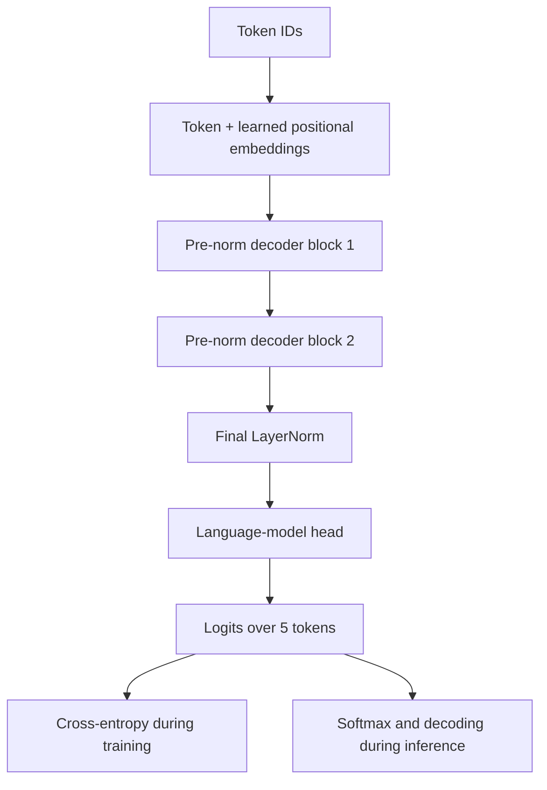

# Understanding Transformers: From Mathematical Foundations to PyTorch

**A small, explicit decoder-only Transformer built for learning, not for benchmark performance.**

This repository connects a working PyTorch implementation to a series of technical tutorials on the mathematical, statistical, and architectural foundations of Transformer language models. Its central idea is to start from an end-to-end model and explore each component at increasing levels of detail.

## The experiment

| Parameter | Value |
| --- | ---: |
| Vocabulary size | 5 |
| Model width (`d_model`) | 4 |
| Attention heads | 2 |
| Head width (`d_head`) | 2 |
| Decoder blocks | 2 |
| FFN intermediate width | 16 |
| Maximum sequence length | 16 |
| Trainable parameters | 573 |

The toy Italian sequence `il gatto mangia pesce` is used solely to expose the next-token training objective. The model takes `il gatto mangia` as input and predicts `gatto mangia pesce` at the corresponding positions. This deliberately tiny dataset supports memorization, **not meaningful language generalization**.

## Architecture



Each decoder block uses **causal multi-head self-attention**, an **MLP with GELU**, **LayerNorm**, **dropout modules**, and **residual connections**. Attention is implemented explicitly from the Q/K/V projections, attention scores, masking, softmax, and weighted aggregation, rather than delegated to `nn.MultiheadAttention`.

## Run locally

```bash
python -m venv .venv
source .venv/bin/activate
python -m pip install -r requirements.txt
python -m src.tiny_transformer
python -m unittest discover -s tests -v
```

PyTorch can run on CPU. If CUDA is available, the example uses it automatically. The one-sequence exercise is intentionally small.

## Learning pathway

1. [Introduction](docs/00-introduction.md)
2. [Architecture and tensor flow](docs/01-architecture.md)
3. [Training and teacher forcing](docs/02-training.md)
4. [Autoregressive inference](docs/03-inference.md)

### Components

- [Token embeddings](docs/modules/01-token-embedding.md)
- [Positional embeddings](docs/modules/02-positional-embedding.md)
- [Causal self-attention](docs/modules/03-causal-self-attention.md)
- [Multi-head attention](docs/modules/04-multi-head-attention.md)
- [Layer normalization](docs/modules/05-layer-normalization.md)
- [Residual connections](docs/modules/06-residual-connections.md)
- [Feed-forward network](docs/modules/07-feed-forward-network.md)
- [Output layer](docs/modules/08-output-layer.md)

### Mathematical deep dives

- [From logits to softmax: an introductory mathematical treatment](docs/deep-dives/from-logits-to-softmax.md)
- [Backpropagation: outline for a future chapter](docs/deep-dives/backpropagation.md)

All mathematical expressions use standard Markdown with `$...$` and `$$...$$` delimiters, which can be used in Obsidian and Markdown renderers supporting math. Relative links work directly on GitHub.

## Scope and development status

The code and automated smoke tests form the working first milestone. Component chapters are concise first drafts; they are intended to be expanded with full derivations, numerical examples, and code cross-references. The softmax deep dive is **not yet a full English translation** of the separate Italian tutorial. There is no claim of performance on realistic language-modeling tasks.

## Historical reference

Vaswani et al., [*Attention Is All You Need*](https://arxiv.org/abs/1706.03762) (2017). This repository implements a small **decoder-only** variant, not the original encoder–decoder architecture.
