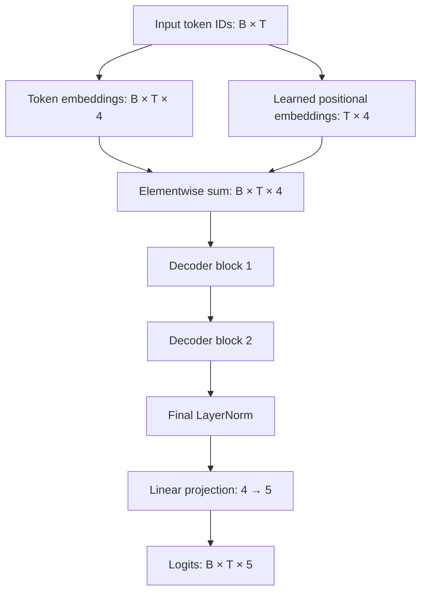
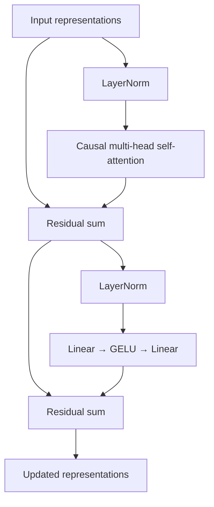

# Decoder-only Transformer: architecture and tensor flow

This document describes the model in [`src/tiny_transformer.py`](../src/tiny_transformer.py). More detailed explanations of individual components live in [`modules/`](modules/).

## A complete forward pass

For this experiment, $B=1$, $T=3$, $d_{\mathrm{model}}=4$, and vocabulary size $V=5$. Thus an input tensor of shape `(1, 3)` produces logits of shape `(1, 3, 5)`.

## A pre-normalization decoder block

Let $X\in\mathbb R^{B\times T\times d_{\mathrm{model}}}$. A decoder block implements

$$
U=X+\operatorname{Attention}(\operatorname{LN}_1(X)),
$$

$$
Y=U+\operatorname{FFN}(\operatorname{LN}_2(U)).
$$

Both sublayers preserve the last tensor dimension. Each block owns its own attention projections, normalization parameters, and feed-forward weights.

## What is learned?

Token and position embeddings, the four attention projections per block, the FFN weights and biases, affine LayerNorm parameters, and the output projection are optimized by gradient descent.

## Shapes to watch

| Stage | Shape |
| --- | --- |
| Token indices | `(1, 3)` |
| Embedded sequence | `(1, 3, 4)` |
| Q, K, V after splitting heads | `(1, 2, 3, 2)` |
| Attention score matrices | `(1, 2, 3, 3)` |
| Concatenated head outputs | `(1, 3, 4)` |
| Decoder output | `(1, 3, 4)` |
| Vocabulary logits | `(1, 3, 5)` |

See [training](02-training.md), [inference](03-inference.md), and the [output-layer tutorial](modules/08-output-layer.md).
