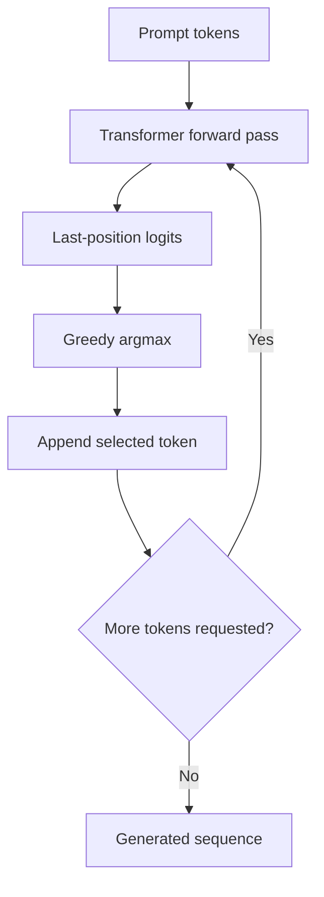

# Inference: autoregressive token generation

During inference the model does not have the next target token. It processes a prefix, takes the vocabulary logits at the **last** position, selects a token, appends it to the prefix, and repeats.

The provided implementation uses **greedy decoding**, `argmax(logits)`, rather than sampling. Applying softmax first would preserve the argmax because softmax is strictly order-preserving for finite logits; probabilities become necessary when sampling or interpreting the predictive distribution.

The model uses learned **absolute positional embeddings** and processes only the latest `max_len` tokens when a generated sequence exceeds the context window. Cropping is a simple demonstration technique, not a substitute for robust long-context behavior.

`model.eval()` disables dropout during inference, and `@torch.no_grad()` avoids creating an autograd graph. This example does not implement KV caching, beam search, temperature sampling, or EOS-based stopping.
