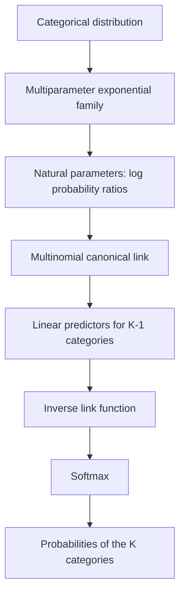

# From Logits to Softmax

Statistical Foundations and Applications in Neural Networks

## Contents of the complete tutorial

- **Introduction:** what softmax is, where it is used, and the aims of this tutorial.
- **1. Generalized Linear Models:** from the classical linear model to the three components of a GLM.
- **2. The exponential family and the canonical link:** general form, cumulant function, mean, variance, and choice of link.
- **3. From Bernoulli to logistic regression:** natural parameter, logit, sigmoid, odds, and interpretation of coefficients.
- **4. Generalization to the multinomial distribution:** one-hot encoding, $K-1$ natural parameters, exponential-family form, and cumulant function.
- **5. Deriving the softmax function:** inversion of the link, reference category, invariance, and examples.
- **6. Softmax in neural networks:** classification, attention, maximum likelihood, cross-entropy, and gradients.
- **7. Statistical inference and uncertainty:** frequentist and Bayesian approaches, and the limitations of softmax probabilities.
- **8. Conclusions:** theoretical synthesis, applications, and final considerations.

To follow: bibliographic references and, if appropriate, an appendix with PyTorch implementations.

## Introduction

**Softmax** is a mathematical function widely used in machine learning to transform a vector of real-valued scores, commonly called *logits*, into a probability distribution over a finite set of categories.

Given a vector of $K$ logits $z_1,\ldots,z_K$, softmax is defined as

$$
\mathrm{softmax}(\mathbf z)_j=
\frac{e^{z_j}}{\sum_{h=1}^{K}e^{z_h}}.
$$

For finite logits in exact arithmetic, the transformation ensures that each resulting value is strictly positive and that the components sum to one.

This property makes softmax particularly natural for **multiclass classification** and **autoregressive language models**, where it represents the probability distribution of the next token. The same function also appears in Transformer *attention* mechanisms, where it serves a different purpose: it normalizes compatibility scores between elements of a sequence, producing weights used to aggregate their representations.

Softmax is not, however, a required component of every neural architecture. Its use depends on the nature of the problem and the chosen parameterization.

Why this particular normalized exponential transformation? What are its statistical foundations, and why does it combine so naturally with *cross-entropy* when training neural networks?

To answer these questions, we will begin with **Generalized Linear Models (GLMs)** and **exponential families of distributions**. We will show how the canonical link of the Bernoulli distribution leads to the *logit* function, and how its generalization to the multinomial distribution produces a vector of log-probability ratios. By inverting this relationship, we will derive softmax.

Finally, we will examine the relationship between the multinomial likelihood, cross-entropy, and gradient calculation, highlighting the mathematical continuity between estimation methods in classical statistics and the optimization procedures used in deep learning.

# 1. Generalized Linear Models (GLMs)

## 1.1 From the classical linear model to GLMs

The **classical linear regression model** describes the relationship between a response variable $Y$ and a set of explanatory variables through a linear combination of the model coefficients.

For a generic observation $i$, we can write

$$
Y_i=\beta_0+\beta_1x_{i1}+\cdots+\beta_px_{ip}+\varepsilon_i,
$$

where:

- $Y_i$ is the response variable;
- $x_{ij}$ is the value of the $j$th explanatory variable for observation $i$;
- $\beta_j$ is the coefficient associated with $x_{ij}$;
- $\beta_0$ is the intercept;
- $\varepsilon_i$ is the error term.

Introducing the covariate vector $x_i$, including an initial component equal to $1$, and the coefficient vector $\beta$, we can express the model compactly as

$$
\boxed{Y_i=x_i^\top\beta+\varepsilon_i.}
$$

### Assumption about the conditional expectation

One of the fundamental assumptions of the linear model concerns the conditional mean of the errors:

$$
\mathbb E[\varepsilon_i\mid x_i]=0.
$$

This assumption states that, conditional on the explanatory variables, the error term has an expected value of zero.

Taking the conditional expectation of both sides of the model gives

$$
\mathbb E[Y_i\mid x_i]
=\mathbb E[x_i^\top\beta+\varepsilon_i\mid x_i].
$$

By linearity of expectation,

$$
\mathbb E[Y_i\mid x_i]
=x_i^\top\beta+\mathbb E[\varepsilon_i\mid x_i].
$$

Since we have assumed that the conditional expectation of the errors is zero,

$$
\boxed{\mu_i=\mathbb E[Y_i\mid x_i]=x_i^\top\beta.}
$$

We therefore obtain a linear relationship between the **conditional expectation of the response variable** and the coefficient vector.

This result does not require the errors to be normally distributed.

### Normality and constant variance assumptions

In the classical Gaussian linear model, we may additionally assume that the errors are conditionally normally distributed, with zero mean and constant variance:

$$
\varepsilon_i\mid x_i\sim\mathcal N(0,\sigma^2).
$$

This implies

$$
\mathbb E[\varepsilon_i\mid x_i]=0
$$

and

$$
\mathrm{Var}(\varepsilon_i\mid x_i)=\sigma^2.
$$

Since $Y_i$ is obtained by adding a deterministic component $x_i^\top\beta$ to a normally distributed error, it follows that

$$
\boxed{Y_i\mid x_i\sim\mathcal N(\mu_i,\sigma^2),}
$$

where

$$
\mu_i=x_i^\top\beta.
$$

We have thus defined a probabilistic model in which the conditional distribution of the response is normal and its mean depends linearly on the covariates.

The usual joint-likelihood formulation also assumes conditional independence of the observations; alternatively, a dependence structure must be specified explicitly.

### Limitations of the Gaussian linear model

This formulation is appropriate for many phenomena, but it may become unsuitable when the response variable has characteristics incompatible with a normal distribution with constant variance.

Consider the following examples:

- A **binary variable** can take only the values $0$ and $1$, representing, for example, the absence or presence of an event.
- A **count variable** takes nonnegative integer values, such as the number of events observed during a time interval.
- A **categorical variable** belongs to one of several mutually exclusive categories.

At least two problems arise in these cases.

The first concerns the **range of the expected value**. For a binary variable, for example,

$$
\mu_i=P(Y_i=1\mid x_i),
$$

so necessarily

$$
0\leq\mu_i\leq1.
$$

A linear combination $x_i^\top\beta$, however, can take any real value and does not guarantee that this constraint is satisfied.

The second problem concerns the **variance structure**. For a Bernoulli variable, for example,

$$
\mathrm{Var}(Y_i\mid x_i)=p_i(1-p_i).
$$

The variance therefore depends on the probability of success and is generally not constant.

These characteristics suggest the need for models that can represent distributions other than the normal distribution and appropriately connect the expected response to the explanatory variables.

**Generalized Linear Models (GLMs)** address this need by extending the linear model through an exponential-family distribution and a function that connects the expected response to the linear predictor.

## 1.2 The three components of a GLM

A Generalized Linear Model is defined by three fundamental components: a random component, a systematic component, and a link function.

### 1. Random component

The random component specifies the conditional distribution of the response variable.

In standard GLMs, this distribution belongs to the **exponential family of distributions**, which includes the normal, Bernoulli, and Poisson distributions, among others.

We can write this assumption generically as

$$
Y_i\mid x_i\sim\mathcal F(\theta_i,\phi),
$$

where:

- $\mathcal F$ denotes an exponential-family distribution;
- $\theta_i$ is the natural parameter of the distribution;
- $\phi$, where applicable, is a dispersion parameter.

We will denote the associated probability mass function or probability density function by

$$
f(y_i;\theta_i,\phi).
$$

The mathematical structure of this family will be examined in the next chapter.

### 2. Systematic component

The systematic component defines the **linear predictor**:

$$
\boxed{\eta_i=x_i^\top\beta,}
$$

where $x_i$ is the covariate vector and $\beta$ is the coefficient vector to be estimated.

The word *linear* refers to the predictor's dependence on the coefficients $\beta$, not necessarily to the original form of the explanatory variables.

The predictor may therefore include transformations of the covariates and interaction terms, provided that the relationship remains linear in the coefficients.

### 3. Link function

The link function connects the conditional expectation of the response to the linear predictor.

Define

$$
\mu_i=\mathbb E[Y_i\mid x_i].
$$

We introduce a function $g$ such that

$$
\boxed{g(\mu_i)=\eta_i=x_i^\top\beta.}
$$

The link function allows us to express the expected value, which may be subject to constraints, through a linear predictor.

If the function is invertible, we can recover the expected value using its inverse:

$$
\boxed{\mu_i=g^{-1}(x_i^\top\beta).}
$$

This relationship is central to GLMs: the inverse link transforms the linear predictor into a value compatible with the mean's domain under the chosen distribution.

For example, the traditional normal linear model can use the **identity link**:

$$
g(\mu_i)=\mu_i,
$$

which gives

$$
\mu_i=x_i^\top\beta.
$$

Gaussian linear regression can therefore be interpreted as a special case of a GLM.

For a Bernoulli distribution, the canonical link is the **logit**, whose inverse is the logistic function, also called the sigmoid.

The choice of link function is not arbitrary: it must be compatible with the domain of the mean and justified by the characteristics of the model. One particularly important choice is the **canonical link**, which directly relates the linear predictor to the natural parameter of the distribution.

We will see how this choice can be derived from the structure of the exponential family and why it is particularly useful for parameter estimation.

---

The next step is to study the exponential family and identify the roles of the natural parameter and the cumulant function. These elements will allow us to derive the canonical link formally and then obtain the logit function from the Bernoulli distribution.

# 2. The exponential family and the canonical link

In the previous chapter, we saw how Generalized Linear Models (GLMs) extend classical linear regression to response variables with different probability distributions.

A fundamental property of standard GLMs is that the conditional response distribution belongs to the **exponential family of distributions**. This family includes many distributions used in statistical modeling, including the normal, Bernoulli, binomial, Poisson, and gamma distributions.

The exponential-family representation identifies a particular parameterization from which we can derive the expected value, variance, and a distinguished link function, called the *canonical link*.

## 2.1 Defining the exponential family

In the parameterization commonly used in GLMs, an exponential-family distribution can be expressed as follows, for a scalar response and $a(\phi)>0$:

$$
\boxed{
f(y;\theta,\phi)=
\exp\left[
\frac{y\theta-b(\theta)}{a(\phi)}
+c(y,\phi)
\right].
}
$$

The terms have different roles:

| Term | Meaning |
| --- | --- |
| $y$ | Observed response value |
| $\theta$ | Natural or canonical parameter |
| $\phi$ | Dispersion parameter, where applicable |
| $b(\theta)$ | Cumulant function, related to normalization and the distribution's moments |
| $a(\phi)$ | Scale function, which enters the variance |
| $c(y,\phi)$ | Term independent of $\theta$, contributing to the distribution's form and normalization |

The dependence on the natural parameter $\theta$ appears through

$$
y\theta-b(\theta).
$$

The function $b(\theta)$ plays a central role: besides contributing to normalization, it contains information about the mean and variance. Under the usual regularity conditions,

$$
\boxed{\mathbb E[Y]=b'(\theta)}
$$

and

$$
\boxed{\mathrm{Var}(Y)=a(\phi)b''(\theta).}
$$

The mean and variance can therefore be obtained from the first and second derivatives of the cumulant function, respectively. Let us derive these results.

## 2.2 Deriving the mean and variance

### The normalization constraint

By definition, a probability mass function or density must be normalized. For a continuous random variable,

$$
\int_{\mathcal Y}f(y;\theta,\phi)\,dy=1,
$$

where $\mathcal Y$ is the distribution's support. In the discrete case, integration is replaced by summation:

$$
\sum_{y\in\mathcal Y}f(y;\theta,\phi)=1.
$$

We will use the continuous case for the proof; the discrete argument is analogous. Assume that the support does not depend on $\theta$ and that the regularity conditions needed to interchange differentiation and integration hold.

### Deriving the expected value

Starting from

$$
\int_{\mathcal Y}f(y;\theta,\phi)\,dy=1,
$$

differentiate both sides with respect to $\theta$, holding $\phi$ fixed:

$$
\frac{\partial}{\partial\theta}
\int_{\mathcal Y}f(y;\theta,\phi)\,dy=0.
$$

Interchanging differentiation and integration gives

$$
\int_{\mathcal Y}
\frac{\partial f(y;\theta,\phi)}{\partial\theta}\,dy=0.
$$

Recall the exponential-family form:

$$
f(y;\theta,\phi)=
\exp\left[
\frac{y\theta-b(\theta)}{a(\phi)}+c(y,\phi)
\right].
$$

Applying the chain rule,

$$
\frac{\partial f(y;\theta,\phi)}{\partial\theta}
=f(y;\theta,\phi)
\frac{\partial}{\partial\theta}
\left[
\frac{y\theta-b(\theta)}{a(\phi)}+c(y,\phi)
\right].
$$

Since $a(\phi)$ and $c(y,\phi)$ do not depend on $\theta$,

$$
\boxed{
\frac{\partial f(y;\theta,\phi)}{\partial\theta}
=f(y;\theta,\phi)\frac{y-b'(\theta)}{a(\phi)}.
}
$$

Substitute this expression into the integral:

$$
\int_{\mathcal Y}
f(y;\theta,\phi)\frac{y-b'(\theta)}{a(\phi)}\,dy=0.
$$

Since $a(\phi)$ is constant with respect to $y$, multiply both sides by it:

$$
\int_{\mathcal Y}[y-b'(\theta)]f(y;\theta,\phi)\,dy=0.
$$

Expanding,

$$
\int_{\mathcal Y}y f(y;\theta,\phi)\,dy
-b'(\theta)\int_{\mathcal Y}f(y;\theta,\phi)\,dy=0.
$$

The first integral is $\mathbb E[Y]$; the second equals $1$ by normalization. Therefore,

$$
\mathbb E[Y]-b'(\theta)=0,
$$

which gives

$$
\boxed{\mathbb E[Y]=b'(\theta).}
$$

Thus **the first derivative of the cumulant function equals the distribution's expected value**.

### Deriving the variance

Use the normalization constraint again, now differentiating twice with respect to $\theta$:

$$
\int_{\mathcal Y}
\frac{\partial^2 f(y;\theta,\phi)}{\partial\theta^2}\,dy=0.
$$

We have already obtained

$$
\frac{\partial f(y;\theta,\phi)}{\partial\theta}
=f(y;\theta,\phi)\frac{y-b'(\theta)}{a(\phi)}.
$$

Differentiate again using the product rule, with $\phi$ fixed:

$$
\frac{\partial^2 f}{\partial\theta^2}
=\frac{\partial f}{\partial\theta}
\frac{y-b'(\theta)}{a(\phi)}
-f(y;\theta,\phi)\frac{b''(\theta)}{a(\phi)}.
$$

Substituting the first derivative,

$$
\boxed{
\frac{\partial^2 f}{\partial\theta^2}
=f(y;\theta,\phi)
\left[
\frac{(y-b'(\theta))^2}{a(\phi)^2}
-\frac{b''(\theta)}{a(\phi)}
\right].
}
$$

Integrating with respect to $y$ gives

$$
\int_{\mathcal Y}f(y;\theta,\phi)
\left[
\frac{(y-b'(\theta))^2}{a(\phi)^2}
-\frac{b''(\theta)}{a(\phi)}
\right]\,dy=0.
$$

Recognizing $b'(\theta)=\mu=\mathbb E[Y]$, and using normalization and the definition of expectation,

$$
\frac{\mathbb E[(Y-\mu)^2]}{a(\phi)^2}
-\frac{b''(\theta)}{a(\phi)}=0.
$$

By definition,

$$
\mathrm{Var}(Y)=\mathbb E[(Y-\mu)^2].
$$

Therefore,

$$
\frac{\mathrm{Var}(Y)}{a(\phi)^2}
=\frac{b''(\theta)}{a(\phi)}.
$$

Multiplying by $a(\phi)^2$ yields

$$
\boxed{\mathrm{Var}(Y)=a(\phi)b''(\theta).}
$$

We have proved both fundamental properties:

$$
\boxed{
\begin{aligned}
\mathbb E[Y]&=b'(\theta),\\
\mathrm{Var}(Y)&=a(\phi)b''(\theta).
\end{aligned}
}
$$

These results directly connect the natural parameter, cumulant function, and first two moments. In particular, since $a(\phi)>0$ and variance is nonnegative,

$$
b''(\theta)\geq0.
$$

Hence $b(\theta)$ is convex in the natural parameter. This will have important consequences for likelihood optimization.

## 2.3 The canonical link function

Recall the linear predictor and link:

$$
\eta_i=x_i^\top\beta,\qquad g(\mu_i)=\eta_i.
$$

Exponential-family theory gives

$$
\mu=b'(\theta).
$$

If this relationship is invertible, the natural parameter can be expressed in terms of the mean:

$$
\theta=(b')^{-1}(\mu).
$$

A GLM uses the **canonical link** when its linear predictor equals the natural parameter:

$$
\boxed{\eta=\theta.}
$$

Consequently, $g(\mu)=\theta$, and

$$
\boxed{g(\mu)=(b')^{-1}(\mu).}
$$

This derives the canonical link directly from the response distribution. Its inverse is

$$
\boxed{\mu=b'(\eta).}
$$

Once we identify $b(\theta)$, we can derive both the canonical link and the relationship that maps the linear predictor to the mean. The canonical link is optional, but it has particularly favorable mathematical properties.

## 2.4 Why choose the canonical link?

One advantage is that it simplifies **maximum-likelihood estimation** of the coefficients.

Suppose we have $n$ conditionally independent observations with exponential-family distributions. The log-likelihood is

$$
\ell(\beta)=\sum_{i=1}^{n}
\left[
\frac{y_i\theta_i-b(\theta_i)}{a(\phi)}
+c(y_i,\phi)
\right].
$$

To find the maximizing coefficients, calculate its gradient. By the chain rule,

$$
\frac{\partial\ell(\beta)}{\partial\beta}
=\sum_{i=1}^{n}
\frac{\partial\ell_i}{\partial\theta_i}
\frac{\partial\theta_i}{\partial\eta_i}
\frac{\partial\eta_i}{\partial\beta}.
$$

From the log-likelihood expression,

$$
\frac{\partial\ell_i}{\partial\theta_i}
=\frac{y_i-b'(\theta_i)}{a(\phi)}.
$$

Since $b'(\theta_i)=\mu_i$ and $\partial\eta_i/\partial\beta=x_i$,

$$
\frac{\partial\ell(\beta)}{\partial\beta}
=\sum_{i=1}^{n}
\frac{y_i-\mu_i}{a(\phi)}
\frac{\partial\theta_i}{\partial\eta_i}\,x_i.
$$

A general link therefore introduces the factor $\partial\theta_i/\partial\eta_i$. For the canonical link,

$$
\theta_i=\eta_i,\qquad
\frac{\partial\theta_i}{\partial\eta_i}=1.
$$

The gradient simplifies to

$$
\boxed{
\nabla_\beta\ell(\beta)
=\sum_{i=1}^{n}\frac{y_i-\mu_i}{a(\phi)}\,x_i.
}
$$

It depends directly on the differences between observations and expected values, weighted by their covariates. This structure is useful in numerical estimation methods.

### Concavity of the log-likelihood

A second advantage concerns second derivatives. With a canonical link and fixed dispersion,

$$
\ell(\beta)=\sum_{i=1}^{n}
\left[
\frac{y_i x_i^\top\beta-b(x_i^\top\beta)}{a(\phi)}
+c(y_i,\phi)
\right].
$$

Differentiating again gives the Hessian:

$$
\boxed{
H(\beta)=
-\sum_{i=1}^{n}
\frac{b''(\theta_i)}{a(\phi)}x_ix_i^\top.
}
$$

Since $b''(\theta_i)\geq0$ and $a(\phi)>0$, the Hessian is negative semidefinite. Under these conditions, the log-likelihood is concave in the coefficients, so any local maximum is also global.

Concavity alone does not guarantee a finite, unique estimator. Additional conditions concern parameter identifiability and the existence of a maximum.

The canonical choice therefore offers two main advantages:

1. It simplifies the maximum-likelihood estimating equations.
2. It gives the log-likelihood a concave structure in the coefficients under the stated conditions.

These properties do not mean that the canonical link always best describes the observed phenomenon.

## 2.5 Why use a different link?

The link function is a modeling choice specifying the relationship between the expected response and the explanatory variables. Mathematical convenience does not necessarily mean the best fit to the relationship in the data.

For a Bernoulli response,

$$
Y\sim\mathrm{Bernoulli}(p),
$$

the canonical link, as we will derive next, is the logit:

$$
g(p)=\ln\left(\frac{p}{1-p}\right).
$$

An alternative is the *probit* link:

$$
g(p)=\Phi^{-1}(p),
$$

where $\Phi$ is the standard normal cumulative distribution function. Inverting it gives

$$
p=\Phi(\eta).
$$

The conditional response distribution remains Bernoulli, but the dependence of the success probability on the predictor changes.

A noncanonical link may be motivated by the phenomenon being studied, the desired interpretation of coefficients, or the model's ability to represent observed relationships. It must remain compatible with the mean's domain and the model assumptions.

**The canonical link is therefore a mathematically privileged choice, not a requirement for defining a GLM.**

---

Next, we apply these properties to the Bernoulli distribution. We will express its probability mass function in exponential-family form, identify the cumulant function, and derive

$$
\theta=\ln\left(\frac{p}{1-p}\right).
$$

Setting $\eta=\theta$ gives the logit link and, by inversion, the logistic or sigmoid function. This provides the foundation for the subsequent generalization to the multinomial distribution and softmax.

# 3. From the Bernoulli Distribution to Logistic Regression

In the previous chapter, we showed how representing a distribution as a member of the exponential family allows us to identify its natural parameter, derive its expected value and variance through the cumulant function, and define a particular link function known as the *canonical link*.

We now apply these results to the **Bernoulli distribution**, which is used to model binary random variables.

We will show how the natural parameter of the Bernoulli distribution leads to the *logit* function and how choosing the canonical link gives rise to the logistic regression model, whose inverse link function is the *sigmoid*.

## 3.1 The Bernoulli Distribution

Consider a random variable $Y$ that can take only two values:

$$
Y\in\{0,1\}
$$

The Bernoulli distribution is particularly well suited to modeling phenomena with two possible outcomes, conventionally called *success* and *failure*.

We write:

$$
Y\sim\mathrm{Bernoulli}(p)
$$

where $p$ denotes the probability of success:

$$
P(Y=1)=p
$$

$$
P(Y=0)=1-p
$$

The Bernoulli probability mass function can be written compactly as:

$$
\boxed{
P(Y=y)=p^y(1-p)^{1-y}
}
$$

where $y\in\{0,1\}$.

We can verify this expression by considering the two possible values separately.

If $y=1$:

$$
P(Y=1)=p^1(1-p)^0=p
$$

If $y=0$:

$$
P(Y=0)=p^0(1-p)^1=1-p
$$

The distribution is therefore completely determined by the parameter $p$. In general, $0\leq p\leq1$; for the logarithmic derivations that follow, we assume $0<p<1$. The boundary cases $p=0$ and $p=1$ are degenerate distributions and can be obtained as limits of the canonical parameterization.

In regression, however, we want this probability to depend on the characteristics of an observation.

For observation $i$, we write:

$$
Y_i\mid x_i\sim\mathrm{Bernoulli}(p_i)
$$

where:

$$
p_i=P(Y_i=1\mid x_i)
$$

Our goal is to build a model that describes the relationship between the covariates $x_i$ and the probability $p_i$.

## 3.2 Representing the Bernoulli Distribution in the Exponential Family

To identify the canonical link, we first need to express the Bernoulli probability mass function in exponential-family form.

We start with:

$$
P(Y=y)=p^y(1-p)^{1-y}
$$

Taking the natural logarithm of both sides:

$$
\ln P(Y=y)=y\ln p+(1-y)\ln(1-p)
$$

Expanding:

$$
\ln P(Y=y)=y\ln p+\ln(1-p)-y\ln(1-p)
$$

Collecting the terms that depend on $y$:

$$
\ln P(Y=y)=y[\ln p-\ln(1-p)]+\ln(1-p)
$$

Using the properties of logarithms:

$$
\ln P(Y=y)=y\ln\left(\frac{p}{1-p}\right)+\ln(1-p)
$$

Returning to exponential form:

$$
\boxed{
P(Y=y)=
\exp\left[
y\ln\left(\frac{p}{1-p}\right)+\ln(1-p)
\right]
}
$$

We compare this expression with the general form of the exponential family:

$$
f(y;\theta,\phi)=
\exp\left[
\frac{y\theta-b(\theta)}{a(\phi)}
+c(y,\phi)
\right]
$$

The term multiplying $y$ allows us to identify the **natural parameter**:

$$
\boxed{
\theta=\ln\left(\frac{p}{1-p}\right)
}
$$

For $0<p<1$, the natural parameter is finite and can take any real value. As $p$ approaches $0$ or $1$, $\theta$ approaches $-\infty$ or $+\infty$, respectively.

We have therefore found a transformation that maps the probability $p$ to a parameter defined over the entire real line.

To complete the exponential-family representation, we need to determine the cumulant function $b(\theta)$.

## 3.3 Deriving the Cumulant Function

We begin with the relationship obtained above:

$$
\theta=\ln\left(\frac{p}{1-p}\right)
$$

Exponentiating both sides:

$$
e^\theta=\frac{p}{1-p}
$$

Multiplying both sides by $1-p$:

$$
e^\theta(1-p)=p
$$

Expanding:

$$
e^\theta-e^\theta p=p
$$

Factoring out $p$:

$$
e^\theta=p(1+e^\theta)
$$

We obtain:

$$
\boxed{
p=\frac{e^\theta}{1+e^\theta}
}
$$

We can therefore also express the complementary probability in terms of $\theta$:

$$
1-p=1-\frac{e^\theta}{1+e^\theta}
$$

Hence:

$$
1-p=\frac{1}{1+e^\theta}
$$

Taking the natural logarithm:

$$
\ln(1-p)=-\ln(1+e^\theta)
$$

Let us return to the probability mass function derived in the previous section:

$$
P(Y=y)=
\exp\left[
y\ln\left(\frac{p}{1-p}\right)+\ln(1-p)
\right]
$$

Substituting the expressions in terms of $\theta$, we obtain:

$$
\boxed{
P(Y=y)=
\exp\left[
y\theta-\ln(1+e^\theta)
\right]
}
$$

Comparing this with the canonical form:

$$
f(y;\theta)=\exp[y\theta-b(\theta)]
$$

we can identify:

$$
\boxed{
b(\theta)=\ln(1+e^\theta)
}
$$

Under the parameterization considered here, the Bernoulli distribution also satisfies:

$$
a(\phi)=1
$$

$$
c(y,\phi)=0
$$

The Bernoulli distribution has no free dispersion parameter, because its variance is completely determined by the probability $p$.

We have thus identified the two fundamental elements:

$$
\boxed{
\begin{aligned}
\theta&=\ln\left(\frac{p}{1-p}\right)\\[6pt]
b(\theta)&=\ln(1+e^\theta)
\end{aligned}
}
$$

## 3.4 Verifying the Expected Value and Variance

In the previous chapter, we demonstrated that, for a distribution in the exponential family under the usual regularity conditions:

$$
\mathbb{E}[Y]=b'(\theta)
$$

$$
\mathrm{Var}(Y)=a(\phi)b''(\theta)
$$

Let us verify that these relationships reproduce the moments of the Bernoulli distribution.

### Expected Value

The cumulant function is:

$$
b(\theta)=\ln(1+e^\theta)
$$

Differentiating with respect to $\theta$:

$$
b'(\theta)=\frac{e^\theta}{1+e^\theta}
$$

But from the previous section we know that:

$$
p=\frac{e^\theta}{1+e^\theta}
$$

Therefore:

$$
\boxed{
\mathbb{E}[Y]=b'(\theta)=p
}
$$

### Variance

Differentiating a second time:

$$
b''(\theta)=
\frac{\partial}{\partial\theta}
\left(
\frac{e^\theta}{1+e^\theta}
\right)
$$

Applying the quotient rule:

$$
b''(\theta)=
\frac{
e^\theta(1+e^\theta)-e^{2\theta}
}{
(1+e^\theta)^2
}
$$

Simplifying:

$$
b''(\theta)=
\frac{e^\theta}{(1+e^\theta)^2}
$$

Since:

$$
p=\frac{e^\theta}{1+e^\theta}
$$

and:

$$
1-p=\frac{1}{1+e^\theta}
$$

we obtain:

$$
b''(\theta)=p(1-p)
$$

Since $a(\phi)=1$:

$$
\boxed{
\mathrm{Var}(Y)=p(1-p)
}
$$

Representing the Bernoulli distribution in the exponential family therefore allows us to recover both its expected value and its variance correctly.

These properties also have an important consequence: the variance of the Bernoulli distribution depends on the probability of success and reaches its maximum at $p=0.5$. Indeed:

$$
p(1-p)=\frac14-\left(p-\frac12\right)^2\leq\frac14
$$

The maximum variance is therefore $1/4$.

## 3.5 The Canonical Link: The Logit Function

We can now apply the theory of generalized linear models (GLMs) directly.

For the Bernoulli distribution, we have shown that:

$$
\mu=\mathbb{E}[Y]=p
$$

and:

$$
\theta=\ln\left(\frac{p}{1-p}\right)
$$

Recall that the canonical link is obtained by setting the natural parameter equal to the linear predictor:

$$
\boxed{
\eta=\theta
}
$$

Substituting $\mu=p$, we obtain:

$$
\boxed{
g(\mu)=\ln\left(\frac{\mu}{1-\mu}\right)
}
$$

This function is called the **logit**:

$$
\boxed{
\mathrm{logit}(p)=
\ln\left(\frac{p}{1-p}\right)
}
$$

The logit function maps the open interval of probabilities onto the real line:

$$
g:(0,1)\longrightarrow\mathbb R
$$

This connection is fundamental because the linear predictor of a GLM can take any real value, whereas a probability must lie in the interval $[0,1]$.

The logit function therefore lets us model an unconstrained quantity on the real scale while retaining a correspondence with a valid probability. For every finite value of the predictor $\eta$, the logistic function returns a probability strictly between $0$ and $1$; the boundary values are reached only in the limit.

### The Logistic Function, or Sigmoid

Consider a model with a single explanatory variable:

$$
\eta=\beta_0+\beta_1x
$$

Choosing the canonical link gives:

$$
\ln\left(\frac{p}{1-p}\right)=\beta_0+\beta_1x
$$

We have already shown that:

$$
p=\frac{e^\theta}{1+e^\theta}
$$

Since $\theta=\eta$, substituting the linear predictor gives:

$$
p=\frac{e^{\beta_0+\beta_1x}}
{1+e^{\beta_0+\beta_1x}}
$$

Dividing the numerator and denominator by $e^{\beta_0+\beta_1x}$:

$$
\boxed{
p=\frac{1}{1+e^{-(\beta_0+\beta_1x)}}
}
$$

This is the **logistic function**, often called the *logistic sigmoid* (the term *sigmoid* can also refer to other S-shaped functions):

$$
\boxed{
\sigma(\eta)=\frac{1}{1+e^{-\eta}}
}
$$

The logistic function is therefore the inverse of the logit:

$$
\boxed{
\sigma=\mathrm{logit}^{-1}
}
$$

The sigmoid is a strictly increasing function whose values lie between $0$ and $1$, excluding the endpoints.

In particular:

$$
\lim_{\eta\to-\infty}\sigma(\eta)=0
$$

$$
\sigma(0)=0.5
$$

$$
\lim_{\eta\to+\infty}\sigma(\eta)=1
$$

We can thus express the conditional probability of the binary response as:

$$
\boxed{
P(Y_i=1\mid x_i)=
\sigma(x_i^\top\beta)
}
$$

This is the **binary logistic regression** model.

In the vector notation $x_i^\top\beta$, the intercept $\beta_0$ is included by assuming that the first component of the covariate vector equals $1$. For example, with one explanatory variable, $x_i=(1,x_i)^\top$ and $\beta=(\beta_0,\beta_1)^\top$; to avoid ambiguity between the vector and the scalar, we can write more precisely $\mathbf{x}_i=(1,x_i)^\top$ and $\mathbf{x}_i^\top\beta=\beta_0+\beta_1x_i$.

The key distinction is that the model is linear on the log-odds scale, but not on the probability scale.

## 3.6 Statistical Interpretation of the Coefficients

One of the main advantages of logistic regression is that its coefficients can be interpreted through a measure of association between the explanatory variables and the response.

To understand this property, we first need to introduce the concept of *odds*.

### Odds

Given a probability of success $p$, we define the odds as:

$$
\boxed{
\mathrm{odds}(p)=\frac{p}{1-p}
}
$$

The odds are the ratio of the probability that an event occurs to the probability that it does not occur.

For example, if:

$$
p=0.8
$$

then:

$$
\mathrm{odds}(p)=\frac{0.8}{0.2}=4
$$

This means that the event is four times as likely to occur as not to occur.

The logit function is simply the natural logarithm of the odds:

$$
\mathrm{logit}(p)=
\ln(\mathrm{odds}(p))
$$

### Interpreting the Coefficient $\beta_1$

Consider again the model:

$$
\mathrm{logit}(p(x))=\beta_0+\beta_1x
$$

Consider an initial value $x$ and a one-unit increase to $x+1$.

At the initial value:

$$
\mathrm{logit}(p(x))=\beta_0+\beta_1x
$$

At the increased value:

$$
\mathrm{logit}(p(x+1))
=\beta_0+\beta_1(x+1)
$$

Expanding:

$$
\mathrm{logit}(p(x+1))
=\beta_0+\beta_1x+\beta_1
$$

Subtracting the two expressions:

$$
\mathrm{logit}(p(x+1))
-
\mathrm{logit}(p(x))
=\beta_1
$$

Substituting the definition of the logit:

$$
\ln\left(
\frac{p(x+1)}{1-p(x+1)}
\right)
-
\ln\left(
\frac{p(x)}{1-p(x)}
\right)
=\beta_1
$$

Using the properties of logarithms:

$$
\ln\left[
\frac{
\mathrm{odds}(p(x+1))
}{
\mathrm{odds}(p(x))
}
\right]
=\beta_1
$$

Exponentiating:

$$
\boxed{
\frac{
\mathrm{odds}(p(x+1))
}{
\mathrm{odds}(p(x))
}
=e^{\beta_1}
}
$$

The resulting ratio is called the **odds ratio (OR)**.

Thus, $e^{\beta_1}$ represents the multiplicative change in the odds associated with a one-unit increase in the explanatory variable $x$.

We can distinguish three cases:

| Coefficient | Odds ratio | Interpretation |
|---|---|---|
| $\beta_1>0$ | $e^{\beta_1}>1$ | The odds increase |
| $\beta_1=0$ | $e^{\beta_1}=1$ | The odds remain unchanged |
| $\beta_1<0$ | $e^{\beta_1}<1$ | The odds decrease |

The interpretation is therefore multiplicative on the odds scale and additive on the log-odds scale.

### Interpreting the Intercept

In the model:

$$
\mathrm{logit}(p(x))=\beta_0+\beta_1x
$$

setting $x=0$:

$$
\mathrm{logit}(p(0))=\beta_0
$$

Consequently:

$$
\boxed{
p(0)=\frac{1}{1+e^{-\beta_0}}
}
$$

The intercept determines the predicted probability when the explanatory variable equals zero.

This interpretation is particularly useful when $x=0$ represents a meaningful condition in the phenomenon being studied.

### Extension to Multiple Covariates

For a model with multiple explanatory variables:

$$
\mathrm{logit}(p(x))=
\beta_0+\beta_1x_1+\cdots+\beta_kx_k
$$

the interpretation generalizes directly.

The coefficient $\beta_j$ represents the change in log-odds associated with a one-unit increase in $x_j$, holding the other covariates constant.

Exponentiating the coefficient:

$$
\boxed{
OR_j=e^{\beta_j}
}
$$

gives the corresponding odds ratio conditional on the other explanatory variables.

This property allows us to quantify the direction and strength of the modeled association between each covariate and the response variable. In the additive log-odds model considered here, with no interaction terms, $OR_j$ is constant across values of the other covariates. When interactions are present, however, the effect of $x_j$ may depend on the other variables.

This is nevertheless a statistical association: a causal interpretation requires additional assumptions about the data-generating process.

## 3.7 Numerical Example: Odds Ratios and Probabilities

Consider a logistic regression model with one explanatory variable:

$$
\mathrm{logit}(p(x))=\beta_0+\beta_1x
$$

Suppose the coefficients take the following values:

$$
\beta_0=\ln\left(\frac14\right)
$$

$$
\beta_1=\ln 2
$$

The corresponding odds ratio is:

$$
OR=e^{\beta_1}=2
$$

This means that a one-unit increase in $x$ doubles the odds of the event.

Let us see what happens to the probabilities.

### Initial Probability

For $x=0$:

$$
\mathrm{logit}(p(0))=\beta_0
$$

Applying the logistic function:

$$
p(0)=\frac{1}{1+e^{-\beta_0}}
$$

Since:

$$
e^{\beta_0}=\frac14
$$

we obtain:

$$
p(0)=\frac{1/4}{1+1/4}=0.2
$$

The initial odds are:

$$
\mathrm{odds}(p(0))=
\frac{0.2}{0.8}=0.25
$$

### Probability After a One-Unit Increase

For $x=1$:

$$
\mathrm{logit}(p(1))=\beta_0+\beta_1
$$

The odds become:

$$
\mathrm{odds}(p(1))
=e^{\beta_0+\beta_1}
$$

Using the properties of the exponential function:

$$
\mathrm{odds}(p(1))
=e^{\beta_0}e^{\beta_1}
$$

Therefore:

$$
\mathrm{odds}(p(1))=
0.25\cdot2=0.5
$$

To recover the probability, we use:

$$
p=\frac{\mathrm{odds}(p)}
{1+\mathrm{odds}(p)}
$$

We obtain:

$$
p(1)=\frac{0.5}{1+0.5}
=\frac13\approx0.333
$$

Let us summarize the results:

| Variable $x$ | Probability $p(x)$ | Odds |
|---|---|---|
| $0$ | $0.200$ | $0.25$ |
| $1$ | $0.333$ | $0.50$ |

A one-unit increase in $x$ therefore doubles the odds, while the probability rises from $20\%$ to approximately $33.3\%$, an increase of about $13.3$ percentage points.

**An odds ratio of $2$ does not mean that the probability doubles.**

This is because the relationship between probabilities and odds is nonlinear.

In general, for a one-unit increase in $x$, we can write:

$$
\boxed{
p(x+1)=
\frac{
e^{\beta_1}p(x)
}{
1-p(x)+e^{\beta_1}p(x)
}
}
$$

The change in probability therefore depends on both the odds ratio and the initial probability.

This distinguishes logistic regression from ordinary linear regression: while $\beta_1$ represents a constant change on the log-odds scale, it does not imply a constant change in probability.

## 3.8 Remarks on Logistic Regression

We have derived binary logistic regression directly from the Bernoulli distribution.

The derivation can be summarized by the following relationships.

**Response distribution:**

$$
Y_i\mid x_i\sim\mathrm{Bernoulli}(p_i)
$$

**Natural parameter:**

$$
\theta_i=\ln\left(\frac{p_i}{1-p_i}\right)
$$

**Canonical link:**

$$
\mathrm{logit}(p_i)=\eta_i=x_i^\top\beta
$$

**Inverse link function:**

$$
\boxed{
p_i=\sigma(x_i^\top\beta)
=\frac{1}{1+e^{-x_i^\top\beta}}
}
$$

We have therefore shown that the logistic function is not introduced arbitrarily; it arises from choosing the canonical link for the Bernoulli distribution.

This choice is mathematically convenient and makes it possible to interpret the coefficients using odds ratios.

However, it is not the only link function that can be used for a Bernoulli response. As discussed in the previous chapter, other links, such as the probit link, allow us to specify different relationships between probabilities and predictors.

The result of greatest interest here is that **the Bernoulli distribution has a single natural parameter, which can be interpreted as the logarithm of the ratio between two complementary probabilities**.

In the next chapter, we will generalize this construction to a response variable with $K$ mutually exclusive categories.

In that case, instead of a single natural parameter, we will obtain a vector of $K-1$ log probability ratios. This generalization will be the key step toward deriving the softmax function.

# 4. Generalization to the Multinomial Distribution

In the previous chapter, we showed how the Bernoulli distribution can be represented as a member of the exponential family, deriving its natural parameter:

$$
\theta=\ln\left(\frac{p}{1-p}\right)
$$

Choosing the canonical link by imposing $\eta=\theta$ leads to the logit function and, through its inverse, to the logistic or sigmoid function.

This construction is particularly well suited to binary classification problems, in which the response variable can take only two values.

We now want to generalize this procedure to a response variable that can belong to one of $K$ mutually exclusive categories.

To do so, we will start from the **categorical distribution**, which is equivalent to a multinomial distribution with a single trial, and show that it too belongs to the exponential family.

We will also see how the probability normalization constraint leads to a representation with $K-1$ natural parameters and a multivariate cumulant function.

## 4.1 From the Bernoulli to the Categorical Distribution

Consider a random variable $Y$ that can take one of $K$ distinct values, with $K\geq 2$:

$$
Y\in\{1,2,\ldots,K\}
$$

Define the probability associated with a generic category $j$:

$$
p_j=P(Y=j)
$$

where:

$$
j=1,\ldots,K
$$

The probabilities must satisfy two conditions:

$$
p_j\geq0
$$

and:

$$
\boxed{
\sum_{j=1}^{K}p_j=1
}
$$

The second condition follows from the fact that the categories are mutually exclusive and exhaustive: each observation belongs to exactly one category.

In the special case $K=2$, the categorical distribution is equivalent to a Bernoulli distribution, apart from the encoding of the categories.

### One-Hot Representation

To represent category membership mathematically, we introduce a vector of indicator variables:

$$
\mathbf Y=(Y_1,Y_2,\ldots,Y_K)
$$

where:

$$
Y_j=
\begin{cases}
1 & \text{if }Y=j\\
0 & \text{otherwise}
\end{cases}
$$

This representation is called **one-hot encoding**.

For example, with three categories, the possible outcomes are:

| Observed category | $Y_1$ | $Y_2$ | $Y_3$ |
|---|---:|---:|---:|
| Class 1 | 1 | 0 | 0 |
| Class 2 | 0 | 1 | 0 |
| Class 3 | 0 | 0 | 1 |

In each case, exactly one component equals $1$, while all the others equal zero.

Consequently:

$$
\boxed{
\sum_{j=1}^{K}Y_j=1
}
$$

The distribution of the vector $\mathbf Y$ can be written as:

$$
\mathbf Y\sim\mathrm{Multinomial}(1,\mathbf p)
$$

where:

$$
\mathbf p=(p_1,p_2,\ldots,p_K)
$$

The first argument of the multinomial distribution specifies the number of trials, which in this case is one.

Therefore, the categorical distribution is the special case of the multinomial distribution with a single trial.

### Probability Mass Function

Using the one-hot representation, the probability mass function can be written as:

$$
\boxed{
P(\mathbf Y=\mathbf y)=
\prod_{j=1}^{K}p_j^{y_j}
}
$$

Let us verify this expression.

Suppose we have three categories and observe the second one:

$$
\mathbf y=(0,1,0)
$$

Then:

$$
P(\mathbf Y=(0,1,0))
=p_1^0p_2^1p_3^0
$$

and therefore:

$$
P(\mathbf Y=(0,1,0))=p_2
$$

The representation correctly returns the probability of the observed category.

For $n$ independent trials with the same category probabilities, the overall category counts instead follow the general multinomial distribution, whose probability mass function also includes the multinomial coefficient.

We will initially consider a single observation and then extend the model to a sample.

## 4.2 The Normalization Constraint and the $K-1$ Degrees of Freedom

Before deriving the exponential-family representation, we must examine an important consequence of the constraint:

$$
\sum_{j=1}^{K}Y_j=1
$$

From this relationship, we can isolate the last component:

$$
\boxed{
Y_K=1-\sum_{j=1}^{K-1}Y_j
}
$$

This means that, once the first $K-1$ components of the vector are known, the last one is uniquely determined.

For example, when $K=3$:

$$
Y_3=1-Y_1-Y_2
$$

The possible configurations are:

| $Y_1$ | $Y_2$ | $Y_3=1-Y_1-Y_2$ |
|---:|---:|---:|
| 1 | 0 | 0 |
| 0 | 1 | 0 |
| 0 | 0 | 1 |

Thus, $Y_1+Y_2$ equals $1$ if either of the first two categories is observed, and $0$ if the third category is observed.

### Free Coordinates and Statistical Independence

The constraint implies that only $K-1$ coordinates are needed to represent the indicator vector.

However, this does not mean that the first $K-1$ variables are statistically independent. For $K\geq 3$, there are at least two indicators among these components, and they are dependent when both corresponding categories have positive probabilities.

Indeed, if one indicator equals $1$, all the others must necessarily equal $0$.

For two distinct categories $j$ and $h$, with $j\neq h$:

$$
P(Y_j=1,Y_h=1)=0
$$

whereas, if both categories have positive probabilities:

$$
P(Y_j=1)P(Y_h=1)=p_jp_h>0
$$

Therefore, the indicators are statistically dependent.

The important distinction is that **the indicator vector is subject to a linear constraint and has only $K-1$ nonredundant coordinates**.

The same principle applies to the probability vector:

$$
\sum_{j=1}^{K}p_j=1
$$

Hence:

$$
\boxed{
p_K=1-\sum_{j=1}^{K-1}p_j
}
$$

Knowing the first $K-1$ probabilities determines the last one.

Nevertheless, the first $K-1$ probabilities cannot be chosen arbitrarily: they must be nonnegative, and their sum must not exceed $1$.

This structure introduces $K-1$ degrees of freedom into the parameterization of the distribution.

For the remainder of the derivation, we assume:

$$
p_j>0,\qquad j=1,\ldots,K
$$

so that all logarithms of probability ratios are well defined and finite. This assumption restricts our discussion to the **interior of the probability simplex**: cases with zero probabilities correspond to limiting values of the natural parameters, not finite values.

## 4.3 Exponential-Family Representation

Recall the probability mass function of the categorical distribution:

$$
P(\mathbf Y=\mathbf y)=
\prod_{j=1}^{K}p_j^{y_j}
$$

Take the natural logarithm:

$$
\ln P(\mathbf Y=\mathbf y)
=
\ln\left(\prod_{j=1}^{K}p_j^{y_j}\right)
$$

Using the properties of logarithms:

$$
\boxed{
\ln P(\mathbf Y=\mathbf y)
=
\sum_{j=1}^{K}y_j\ln p_j
}
$$

Our goal is to rewrite this expression in the form of a multiparameter exponential family.

### Introducing a Reference Category

Since only $K-1$ probabilities are free, we can choose one category as the reference and express the other probabilities relative to it.

By convention, we choose category $K$.

From the constraint on the one-hot representation:

$$
y_K=1-\sum_{j=1}^{K-1}y_j
$$

Separate the term corresponding to the reference category:

$$
\ln P(\mathbf Y=\mathbf y)
=
\sum_{j=1}^{K-1}y_j\ln p_j
+y_K\ln p_K
$$

Substitute the expression for $y_K$:

$$
\begin{aligned}
\ln P(\mathbf Y=\mathbf y)
&=
\sum_{j=1}^{K-1}y_j\ln p_j\\
&\quad+
\left(1-\sum_{j=1}^{K-1}y_j\right)\ln p_K
\end{aligned}
$$

Expanding:

$$
\begin{aligned}
\ln P(\mathbf Y=\mathbf y)
&=
\sum_{j=1}^{K-1}y_j\ln p_j
+\ln p_K\\
&\quad-
\sum_{j=1}^{K-1}y_j\ln p_K
\end{aligned}
$$

Collect the terms involving $y_j$:

$$
\ln P(\mathbf Y=\mathbf y)
=
\sum_{j=1}^{K-1}
y_j(\ln p_j-\ln p_K)
+\ln p_K
$$

Applying the logarithm-of-a-ratio identity:

$$
\boxed{
\ln P(\mathbf Y=\mathbf y)
=
\sum_{j=1}^{K-1}
y_j\ln\left(\frac{p_j}{p_K}\right)
+\ln p_K
}
$$

This expression is analogous to the one obtained for the Bernoulli distribution.

In the binary case, we identified the natural parameter:

$$
\theta=\ln\left(\frac{p}{1-p}\right)
$$

In the categorical case, we can instead identify one natural parameter for each of the first $K-1$ categories:

$$
\boxed{
\theta_j=
\ln\left(\frac{p_j}{p_K}\right),
\qquad j=1,\ldots,K-1
}
$$

We thus obtain a vector of natural parameters:

$$
\boxed{
\boldsymbol\theta=
\begin{pmatrix}
\theta_1\\
\theta_2\\
\vdots\\
\theta_{K-1}
\end{pmatrix}
}
$$

where:

$$
\boldsymbol\theta\in\mathbb R^{K-1}
$$

Each parameter $\theta_j$ represents the logarithm of the ratio between the probability of category $j$ and that of the reference category $K$. This is the **minimal reference-category parameterization**: choosing category $K$ is a convention, while the number of free natural coordinates remains $K-1$.

For $K>2$, unlike the Bernoulli distribution, the categorical distribution requires multiple natural parameters. When $K=2$, we recover the single Bernoulli parameter: setting $p_1=p$ and $p_2=1-p$ yields $\theta_1=\ln[p/(1-p)]$.

The next step is to derive the corresponding cumulant function.

## 4.4 Deriving the Multivariate Cumulant Function

Starting from the definition of the natural parameters:

$$
\theta_j=\ln\left(\frac{p_j}{p_K}\right)
$$

exponentiate both sides:

$$
e^{\theta_j}=\frac{p_j}{p_K}
$$

Multiplying by $p_K$:

$$
\boxed{
p_j=p_Ke^{\theta_j}
}
$$

This relationship allows us to express the probability of each category relative to that of the reference category.

### Using the Normalization Constraint

We know that:

$$
\sum_{j=1}^{K}p_j=1
$$

Separate the probability of category $K$:

$$
p_K+\sum_{j=1}^{K-1}p_j=1
$$

Substitute:

$$
p_j=p_Ke^{\theta_j}
$$

We obtain:

$$
p_K+\sum_{j=1}^{K-1}p_Ke^{\theta_j}=1
$$

Factor out $p_K$:

$$
p_K\left(
1+\sum_{j=1}^{K-1}e^{\theta_j}
\right)=1
$$

Hence:

$$
\boxed{
p_K=
\frac{1}
{1+\sum_{j=1}^{K-1}e^{\theta_j}}
}
$$

We have now expressed the probability of the reference category as a function of the $K-1$ natural parameters.

### Deriving the Other Probabilities

For the first $K-1$ categories, we previously obtained:

$$
p_j=p_Ke^{\theta_j}
$$

Substitute the expression just derived for $p_K$:

$$
p_j=
\left(
\frac{1}
{1+\sum_{h=1}^{K-1}e^{\theta_h}}
\right)e^{\theta_j}
$$

Moving the exponential factor to the numerator:

$$
\boxed{
p_j=
\frac{e^{\theta_j}}
{1+\sum_{h=1}^{K-1}e^{\theta_h}},
\qquad j=1,\ldots,K-1
}
$$

The index $j$ identifies the category whose probability we want to calculate, while $h$ is the summation index used to include the contributions from all non-reference categories.

The probabilities therefore share the same denominator.

### Identifying the Cumulant Function

Recall the log-probability derived in the previous section:

$$
\ln P(\mathbf Y=\mathbf y)
=
\sum_{j=1}^{K-1}y_j\theta_j+\ln p_K
$$

Since:

$$
p_K=
\frac{1}
{1+\sum_{j=1}^{K-1}e^{\theta_j}}
$$

taking the logarithm gives:

$$
\ln p_K=
-\ln\left(
1+\sum_{j=1}^{K-1}e^{\theta_j}
\right)
$$

Substituting:

$$
\begin{aligned}
\ln P(\mathbf Y=\mathbf y)
&=
\sum_{j=1}^{K-1}y_j\theta_j\\
&\quad-
\ln\left(
1+\sum_{j=1}^{K-1}e^{\theta_j}
\right)
\end{aligned}
$$

We identify the **multivariate cumulant function**:

$$
\boxed{
A(\boldsymbol\theta)=
\ln\left(
1+\sum_{j=1}^{K-1}e^{\theta_j}
\right)
}
$$

The probability mass function can therefore be expressed as:

$$
\boxed{
P(\mathbf Y=\mathbf y)=
\exp\left[
\sum_{j=1}^{K-1}y_j\theta_j
-A(\boldsymbol\theta)
\right]
}
$$

Or, using the dot product:

$$
\boxed{
P(\mathbf Y=\mathbf y)=
\exp\left[
\mathbf y_{1:K-1}^{\top}\boldsymbol\theta
-A(\boldsymbol\theta)
\right]
}
$$

where $\mathbf y_{1:K-1}$ denotes the vector formed by the first $K-1$ components of the one-hot encoding.

We have thus shown that the categorical distribution belongs to the multiparameter exponential family.

The main difference from the Bernoulli distribution, when $K>2$, concerns the dimensionality of the parameters: rather than a single natural parameter $\theta$, we have a vector $\boldsymbol\theta$ of dimension $K-1$.

Consequently, the cumulant function $b(\theta)$ is generalized to the multivariate function $A(\boldsymbol\theta)$.

## 4.5 Expected Value and Covariance Matrix

In Chapter 2, we showed that, for the exponential family under the parameterization considered:

$$
\mathbb E[Y]=b'(\theta)
$$

$$
\mathrm{Var}(Y)=a(\phi)b''(\theta)
$$

In the categorical case, the cumulant function depends on a vector of parameters.

Ordinary derivatives are therefore replaced by the **gradient** and the **Hessian matrix**.

For the exponential-family representation just derived, we have:

$$
\boxed{
\mathbb E[\mathbf Y_{1:K-1}]
=
\nabla A(\boldsymbol\theta)
}
$$

and:

$$
\boxed{
\mathrm{Cov}(\mathbf Y_{1:K-1})
=
\nabla^2 A(\boldsymbol\theta)
}
$$

These relationships are the multivariate generalization of the properties already studied for the Bernoulli distribution. In this exponential-family form, the scale factor is one, so the term $a(\phi)$ from the general GLM variance formula does not appear.

### Deriving the Expected Value

We have:

$$
A(\boldsymbol\theta)=
\ln\left(
1+\sum_{h=1}^{K-1}e^{\theta_h}
\right)
$$

Calculate the partial derivative with respect to $\theta_j$:

$$
\frac{\partial A}{\partial\theta_j}
=
\frac{\partial}{\partial\theta_j}
\ln\left(
1+\sum_{h=1}^{K-1}e^{\theta_h}
\right)
$$

Applying the chain rule:

$$
\frac{\partial A}{\partial\theta_j}
=
\frac{
\frac{\partial}{\partial\theta_j}
\left(1+\sum_{h=1}^{K-1}e^{\theta_h}\right)
}{
1+\sum_{h=1}^{K-1}e^{\theta_h}
}
$$

Since only the term with $h=j$ in the sum depends on $\theta_j$:

$$
\frac{\partial A}{\partial\theta_j}
=
\frac{e^{\theta_j}}
{1+\sum_{h=1}^{K-1}e^{\theta_h}}
$$

We recognize the probability $p_j$ derived earlier:

$$
\boxed{
\frac{\partial A}{\partial\theta_j}=p_j
}
$$

Therefore:

$$
\boxed{
\nabla A(\boldsymbol\theta)
=
\begin{pmatrix}
p_1\\
p_2\\
\vdots\\
p_{K-1}
\end{pmatrix}
}
$$

This result is consistent with the definition of the indicator variables.

Indeed, for each category:

$$
\begin{aligned}
\mathbb E[Y_j]
&=1\cdot P(Y_j=1)+0\cdot P(Y_j=0)\\
&=p_j
\end{aligned}
$$

Thus, the first derivative of the cumulant function returns the probabilities of the first $K-1$ categories.

The probability of the reference category is determined by the constraint:

$$
p_K=1-\sum_{j=1}^{K-1}p_j
$$

### Deriving the Covariance Matrix

Now consider the second derivatives of $A(\boldsymbol\theta)$.

Since:

$$
\frac{\partial A}{\partial\theta_j}=p_j
$$

we have:

$$
\frac{\partial^2 A}
{\partial\theta_h\partial\theta_j}
=
\frac{\partial p_j}{\partial\theta_h}
$$

Recall that:

$$
p_j=
\frac{e^{\theta_j}}
{1+\sum_{r=1}^{K-1}e^{\theta_r}}
$$

We distinguish two cases.

**Case 1: $j=h$**

Differentiating with respect to $\theta_j$:

$$
\frac{\partial p_j}{\partial\theta_j}
=
\frac{
e^{\theta_j}\left(1+\sum_{r=1}^{K-1}e^{\theta_r}\right)
-e^{2\theta_j}
}{
\left(1+\sum_{r=1}^{K-1}e^{\theta_r}\right)^2
}
$$

Recognizing $p_j$, we obtain:

$$
\boxed{
\frac{\partial p_j}{\partial\theta_j}
=p_j(1-p_j)
}
$$

**Case 2: $j\neq h$**

In this case, the numerator $e^{\theta_j}$ does not depend on $\theta_h$.

Applying the quotient rule:

$$
\frac{\partial p_j}{\partial\theta_h}
=
-\frac{
e^{\theta_j}e^{\theta_h}
}{
\left(1+\sum_{r=1}^{K-1}e^{\theta_r}\right)^2
}
$$

Therefore:

$$
\boxed{
\frac{\partial p_j}{\partial\theta_h}
=-p_jp_h
}
$$

The two relationships can be expressed using the Kronecker delta:

$$
\delta_{jh}=
\begin{cases}
1 & \text{if }j=h\\
0 & \text{if }j\neq h
\end{cases}
$$

We obtain:

$$
\boxed{
\frac{\partial^2 A}
{\partial\theta_j\partial\theta_h}
=
p_j(\delta_{jh}-p_h)
}
$$

This expression gives the entries of the covariance matrix of the indicator vector.

For $j=h$:

$$
\mathrm{Var}(Y_j)=p_j(1-p_j)
$$

For $j\neq h$:

$$
\mathrm{Cov}(Y_j,Y_h)=-p_jp_h
$$

The negative covariances reflect the mutually exclusive nature of the categories: if one category is observed, the others cannot be observed in the same trial.

The matrix can be written in compact form:

$$
\boxed{
\mathrm{Cov}(\mathbf Y_{1:K-1})
=
\mathrm{diag}(\mathbf p_{1:K-1})
-
\mathbf p_{1:K-1}\mathbf p_{1:K-1}^{\top}
}
$$

This result highlights how the multivariate cumulant function encodes both the category probabilities and the structure of their dependencies.

**A note on dimensionality.** The matrix just derived is the covariance matrix of the reduced vector $\mathbf Y_{1:K-1}$ and has dimensions $(K-1)\times(K-1)$. If $p_1,\ldots,p_K>0$, it is positive definite. By contrast, the covariance matrix of the full one-hot vector $\mathbf Y$ is $\mathrm{diag}(\mathbf p)-\mathbf p\mathbf p^\top$; it has dimensions $K\times K$ and is singular because $\sum_jY_j=1$ imposes a linear dependence among the components.

## 4.6 Numerical Example with Three Categories

Consider a categorical distribution with:

$$
K=3
$$

Choose the third category as the reference and define the natural parameters:

$$
\theta_1=\ln 2
$$

$$
\theta_2=\ln 3
$$

By definition:

$$
e^{\theta_1}=\frac{p_1}{p_3}=2
$$

$$
e^{\theta_2}=\frac{p_2}{p_3}=3
$$

We therefore obtain:

$$
p_1=2p_3
$$

$$
p_2=3p_3
$$

Use the normalization constraint:

$$
p_1+p_2+p_3=1
$$

Substituting:

$$
2p_3+3p_3+p_3=1
$$

Hence:

$$
6p_3=1
$$

and:

$$
p_3=\frac16
$$

The other probabilities are:

$$
p_1=2\cdot\frac16=\frac26
$$

$$
p_2=3\cdot\frac16=\frac36
$$

Thus:

$$
\boxed{
\mathbf p=
\left(
\frac26,\frac36,\frac16
\right)
}
$$

Verify that:

$$
\frac26+\frac36+\frac16=1
$$

The cumulant function is:

$$
A(\boldsymbol\theta)
=
\ln(1+e^{\theta_1}+e^{\theta_2})
$$

Substituting:

$$
A(\boldsymbol\theta)=\ln(1+2+3)
$$

We obtain:

$$
\boxed{
A(\boldsymbol\theta)=\ln 6
}
$$

If we observe the second category:

$$
\mathbf y=(0,1,0)
$$

the exponential-family representation gives:

$$
P(\mathbf Y=\mathbf y)
=
\exp[y_1\theta_1+y_2\theta_2-A(\boldsymbol\theta)]
$$

Substituting:

$$
P(\mathbf Y=(0,1,0))
=
\exp[0\cdot\ln2+1\cdot\ln3-\ln6]
$$

Thus:

$$
P(\mathbf Y=(0,1,0))
=
e^{\ln3-\ln6}
$$

and finally:

$$
\boxed{
P(\mathbf Y=(0,1,0))=\frac36=\frac12
}
$$

We have verified that the exponential-family representation correctly reproduces the probability of the observed category.

## 4.7 Toward the Multinomial Canonical Link

We can now summarize the results.

The categorical distribution belongs to the multiparameter exponential family and has a vector of $K-1$ natural parameters:

$$
\boxed{
\theta_j=\ln\left(\frac{p_j}{p_K}\right),
\qquad j=1,\ldots,K-1
}
$$

The cumulant function is:

$$
\boxed{
A(\boldsymbol\theta)=
\ln\left(
1+\sum_{j=1}^{K-1}e^{\theta_j}
\right)
}
$$

The category probabilities can be obtained from:

$$
p_j=
\frac{e^{\theta_j}}
{1+\sum_{h=1}^{K-1}e^{\theta_h}}
$$

for $j=1,\ldots,K-1$, while the reference-category probability is:

$$
p_K=
\frac{1}
{1+\sum_{h=1}^{K-1}e^{\theta_h}}
$$

We also showed that:

$$
\mathbb E[\mathbf Y_{1:K-1}]
=
\nabla A(\boldsymbol\theta)
$$

and:

$$
\mathrm{Cov}(\mathbf Y_{1:K-1})
=
\nabla^2A(\boldsymbol\theta)
$$

**The key result is that the categorical distribution can be represented using $K-1$ log-ratios of probabilities**, rather than a single logit as in the Bernoulli case.

This structure allows us to generalize the concept of the canonical link from the scalar to the vector case.

In the next chapter, we will define a linear predictor for each of the $K-1$ non-reference categories, setting the predictors equal to the natural parameters.

By inverting the multinomial canonical link, we will obtain the softmax function.

We will also examine why the logit of a reference category can be fixed at zero, the role of the softmax function's invariance under additive shifts, and how binary logistic regression emerges as a special case of the multinomial construction.

# 5. From the Multinomial Canonical Link to the Softmax Function

In the previous chapter, we showed that the categorical distribution belongs to the multiparameter exponential family and that its natural parameters can be expressed as log ratios of category probabilities.

Choosing category $K$ as the reference, we obtained:

$$
\theta_j=\ln\left(\frac{p_j}{p_K}\right),
\qquad j=1,\ldots,K-1
$$

This relationship provides the starting point for generalizing binary logistic regression to the multiclass setting.

Our goal now is to connect the natural parameters to the linear predictors of a generalized linear model (GLM) and derive the function that transforms these predictors into probabilities for the $K$ categories.

We will show that this function is precisely the **softmax**, widely used in classification models and modern neural network architectures.

## 5.1 The Multinomial Canonical Link

Recall the vector of natural parameters for the categorical distribution:

$$
\boldsymbol\theta=
\begin{pmatrix}
\ln(p_1/p_K)\\
\ln(p_2/p_K)\\
\vdots\\
\ln(p_{K-1}/p_K)
\end{pmatrix}
$$

In the Bernoulli case, we defined the canonical link by setting the natural parameter equal to the linear predictor:

$$
\eta=\theta
$$

In the multinomial case, we can generalize this construction by introducing a linear predictor for each of the $K-1$ non-reference categories.

For an arbitrary observation described by a covariate vector $x$, define:

$$
\eta_j=x^\top\beta_j,
\qquad j=1,\ldots,K-1
$$

where $\beta_j$ denotes the vector of coefficients associated with category $j$. If the model includes an intercept, we assume that $x$ contains a constant component equal to $1$.

As in the previous chapter, we assume that all probabilities are strictly positive: $p_j>0$. This ensures that the log probability ratios and their corresponding natural parameters are finite.

We thus obtain a vector of linear predictors:

$$
\boldsymbol\eta=
\begin{pmatrix}
\eta_1\\
\eta_2\\
\vdots\\
\eta_{K-1}
\end{pmatrix}
$$

Choosing the **multinomial canonical link** means imposing:

$$
\boxed{
\boldsymbol\eta=\boldsymbol\theta
}
$$

Therefore, for each non-reference category:

$$
\boxed{
\ln\left(\frac{p_j}{p_K}\right)
=x^\top\beta_j
}
$$

The canonical link thus takes the following vector-valued form:

$$
\boxed{
g(\mathbf p)=
\begin{pmatrix}
\ln(p_1/p_K)\\
\ln(p_2/p_K)\\
\vdots\\
\ln(p_{K-1}/p_K)
\end{pmatrix}
}
$$

This function is known as the **baseline-category logit link**, because it expresses each category's probability through its ratio to the probability of a reference category.

### Inverting the Canonical Link

Starting from the definition:

$$
\ln\left(\frac{p_j}{p_K}\right)=\eta_j
$$

exponentiate both sides:

$$
\frac{p_j}{p_K}=e^{\eta_j}
$$

Hence:

$$
p_j=p_Ke^{\eta_j}
$$

Use the normalization constraint:

$$
p_K+\sum_{j=1}^{K-1}p_j=1
$$

Substituting:

$$
p_K+\sum_{j=1}^{K-1}p_Ke^{\eta_j}=1
$$

Factoring out $p_K$:

$$
p_K\left(1+\sum_{j=1}^{K-1}e^{\eta_j}\right)=1
$$

We obtain:

$$
\boxed{
p_K=
\frac{1}{1+\sum_{h=1}^{K-1}e^{\eta_h}}
}
$$

For the remaining categories, use the relationship $p_j=p_Ke^{\eta_j}$:

$$
p_j=
\left(
\frac{1}{1+\sum_{h=1}^{K-1}e^{\eta_h}}
\right)e^{\eta_j}
$$

Therefore:

$$
\boxed{
p_j=
\frac{e^{\eta_j}}
{1+\sum_{h=1}^{K-1}e^{\eta_h}},
\qquad j=1,\ldots,K-1
}
$$

We have thus derived the inverse of the multinomial canonical link.

More precisely, the link $g$ maps strictly positive category probabilities to a vector of $K-1$ log ratios; its inverse maps any vector $\boldsymbol\eta\in\mathbb R^{K-1}$ to a unique probability vector in the interior of the simplex. Once a reference category has been chosen, this is a one-to-one correspondence.

This parameterization already defines a **multinomial logistic regression** model, in which the probabilities are determined by the linear predictors for the $K-1$ non-reference categories.

## 5.2 From the Reference Category to the Softmax

The representation derived above explicitly distinguishes category $K$ from the others.

However, we can adopt a more symmetric notation by introducing a vector of $K$ real-valued scores, called *logits*:

$$
\mathbf z=(z_1,z_2,\ldots,z_K)
$$

First, define:

$$
z_j=\eta_j,\qquad j=1,\ldots,K-1
$$

and choose:

$$
z_K=0
$$

Since:

$$
e^{z_K}=e^0=1
$$

the denominator of the probabilities can be rewritten as:

$$
1+\sum_{h=1}^{K-1}e^{\eta_h}
=
\sum_{h=1}^{K}e^{z_h}
$$

Consequently, we can use a single expression for all $K$ categories:

$$
\boxed{
p_j=\mathrm{softmax}(\mathbf z)_j
=
\frac{e^{z_j}}{\sum_{h=1}^{K}e^{z_h}}
}
$$

This is the **softmax function**.

The softmax transforms a vector of $K$ real numbers into a probability vector:

$$
\mathrm{softmax}:
\mathbb R^K\longrightarrow\Delta_{K-1}^{\circ}
$$

where:

$$
\Delta_{K-1}^{\circ}
=
\left\{
\mathbf p\in\mathbb R^K:
p_j>0,\ \sum_{j=1}^{K}p_j=1
\right\}
$$

denotes the relative interior of the probability simplex for $K$ categories.

**A clarification:** the softmax with $K$ logits is not injective, because different logit vectors can produce the same distribution. The true inverse of the *baseline-category logit link* is obtained by restricting the softmax to vectors of the form $(\eta_1,\ldots,\eta_{K-1},0)$. Symbolically:

$$
\boxed{g^{-1}(\boldsymbol\eta)=\mathrm{softmax}(\eta_1,\ldots,\eta_{K-1},0)}
$$

Nevertheless, the softmax with $K$ logits is surjective onto the interior of the simplex: every distribution with strictly positive probabilities can be obtained from a suitable logit vector.

The function has two immediate properties.

**Positivity**

Because the exponential function is always strictly positive:

$$
e^{z_j}>0
$$

we have:

$$
p_j>0
$$

for every finite logit.

**Normalization**

Summing the probabilities:

$$
\begin{aligned}
\sum_{j=1}^{K}p_j
&=
\sum_{j=1}^{K}
\frac{e^{z_j}}{\sum_{h=1}^{K}e^{z_h}}\\
&=
\frac{\sum_{j=1}^{K}e^{z_j}}
{\sum_{h=1}^{K}e^{z_h}}\\
&=1
\end{aligned}
$$

We therefore obtain a valid probability vector.

One important question remains: **why can we set $z_K=0$ without restricting the distribution?**

To understand this, we need to examine a fundamental property of the softmax.

## 5.3 Translation Invariance of the Softmax

Consider an arbitrary vector of logits:

$$
\mathbf z=(z_1,z_2,\ldots,z_K)
$$

The corresponding probabilities are:

$$
p_j=
\frac{e^{z_j}}{\sum_{h=1}^{K}e^{z_h}}
$$

Now suppose that we add the same constant $c$ to every component:

$$
z'_j=z_j+c
$$

The new vector is:

$$
\mathbf z'=\mathbf z+c\mathbf1
$$

where $\mathbf1$ denotes a vector of $K$ components, all equal to one.

Apply the softmax:

$$
p'_j=
\frac{e^{z_j+c}}
{\sum_{h=1}^{K}e^{z_h+c}}
$$

Using the properties of exponentials:

$$
p'_j=
\frac{e^{z_j}e^c}
{\sum_{h=1}^{K}e^{z_h}e^c}
$$

Because $e^c$ is common to every term in the denominator, we can factor it out:

$$
p'_j=
\frac{e^{z_j}e^c}
{e^c\sum_{h=1}^{K}e^{z_h}}
$$

Simplifying:

$$
p'_j=
\frac{e^{z_j}}
{\sum_{h=1}^{K}e^{z_h}}
$$

Therefore:

$$
\boxed{
p'_j=p_j
}
$$

We have shown that:

$$
\boxed{
\mathrm{softmax}(\mathbf z+c\mathbf1)
=
\mathrm{softmax}(\mathbf z)
}
$$

This property is called **translation invariance**.

It means that adding or subtracting the same quantity from every logit does not change the resulting probabilities.

### Why Do Only Differences Between Logits Matter?

Consider the ratio of the probabilities of two categories, $j$ and $h$:

$$
\frac{p_j}{p_h}
=
\frac{
e^{z_j}/\sum_{r=1}^{K}e^{z_r}
}{
e^{z_h}/\sum_{r=1}^{K}e^{z_r}
}
$$

The denominators cancel:

$$
\frac{p_j}{p_h}
=
\frac{e^{z_j}}{e^{z_h}}
$$

Therefore:

$$
\boxed{
\frac{p_j}{p_h}=e^{z_j-z_h}
}
$$

Taking the natural logarithm:

$$
\boxed{
\ln\left(\frac{p_j}{p_h}\right)=z_j-z_h
}
$$

This relationship shows that probability ratios depend exclusively on the **differences between logits**.

The absolute values of the logits therefore have no independent probabilistic meaning.

If we increase or decrease every logit by the same amount, their differences remain unchanged, and so do the probability ratios.

Because the probabilities must sum to one, these ratios uniquely determine the distribution.

## 5.4 Why Can We Choose $z_K=0$?

The property just established answers this question.

Consider a generic vector:

$$
\mathbf z=(z_1,z_2,\ldots,z_K)
$$

We know that we can subtract the same constant from every component without changing the probabilities.

Choose:

$$
c=-z_K
$$

This gives the transformed vector:

$$
\mathbf z'=
(z_1-z_K,\ z_2-z_K,\ldots,z_K-z_K)
$$

Therefore:

$$
\boxed{
\mathbf z'=
(z_1-z_K,\ z_2-z_K,\ldots,0)
}
$$

The final component is now zero, but:

$$
\mathrm{softmax}(\mathbf z')
=
\mathrm{softmax}(\mathbf z)
$$

**We are not assuming that the original logit of category $K$ is zero: we are choosing an equivalent representation of the same distribution.**

Subtracting $z_K$ can be done separately for each observation, even when the reference logit depends on the covariates $x$. In a linear model, the differences $z_j(x)-z_K(x)$ remain linear predictors.

This is possible because the logits are not uniquely determined by the probabilities.

### Connection to the Natural Parameters

In Chapter 4, we defined:

$$
\theta_j=\ln\left(\frac{p_j}{p_K}\right)
$$

From the softmax probability-ratio identity, we know that:

$$
\ln\left(\frac{p_j}{p_K}\right)=z_j-z_K
$$

Therefore:

$$
\boxed{
\theta_j=z_j-z_K
}
$$

If we choose the representation with $z_K=0$, we obtain:

$$
\boxed{
\theta_j=z_j,
\qquad j=1,\ldots,K-1
}
$$

The logits of the non-reference categories thus coincide directly with the natural parameters of the categorical distribution.

This explains why the reference-category representation arises naturally from the exponential-family derivation.

### The Identifiability Problem

The fact that different logit vectors can produce the same distribution introduces redundancy into the parameterization.

For example:

$$
\mathbf z=(2,1,0)
$$

and:

$$
\mathbf z'=(5,4,3)
$$

produce exactly the same probabilities, because:

$$
\mathbf z'=\mathbf z+3\mathbf1
$$

Thus, we cannot distinguish the two vectors by observing the probabilities alone.

This is an **identifiability** problem: multiple parameter configurations represent the same distribution.

In particular, a vector of $K$ logits contains one redundant direction, corresponding to the addition of a common constant.

Only $K-1$ differences are needed to identify the distribution.

This observation concerns the identifiability of **logits for a given observation**. In a regression model with $K$ unconstrained linear predictors, the redundancy also affects the coefficients: adding or subtracting the same coefficient vector for every class does not change the predicted probabilities. Setting the reference class's coefficient vector to zero eliminates this particular redundancy, provided that no additional identifiability problems, such as perfectly collinear covariates, are present.

The choice:

$$
z_K=0
$$

eliminates this redundancy by fixing a reference category.

We can interpret it as choosing a coordinate system: changing the reference changes the values used to represent the distribution, but not the probabilities themselves.

This property is directly connected to the constraint:

$$
\sum_{j=1}^{K}p_j=1
$$

Indeed, the probability vector also has only $K-1$ free coordinates.

In summary, **logit redundancy and the probability normalization constraint are two closely related aspects of the same probabilistic structure**.

Starting with a logit vector produced by a neural network, applying the softmax is theoretically justified by the categorical (or single-trial multinomial) distribution, its membership in the exponential family, and the associated canonical parameterization.

Two fundamental properties emerge from this structure:

1. **Differences between logits represent the log-odds** of the corresponding categories relative to a reference category, and therefore express the distribution's natural parameters.

2. **Probabilities are invariant under a common translation of all logits**, making it possible to set the logit of a chosen reference category to zero without changing the probability distribution.

The softmax thus transforms a vector of unconstrained real values into a probability distribution consistent with the multinomial logistic model.

It is also important to emphasize that:

$$
z_K=0
\quad\not\Rightarrow\quad
p_K=0
$$

Indeed, in the reference-category representation:

$$
p_K=
\frac{e^0}{\sum_{h=1}^{K}e^{z_h}}
=
\frac{1}{\sum_{h=1}^{K}e^{z_h}}
$$

and this probability is strictly positive for finite logits.

## 5.5 Numerical Example with Three Categories

Consider a classification problem with three categories.

Suppose the model produces the following logit vector:

$$
\mathbf z=(2,1,0)
$$

Apply the softmax:

$$
p_j=
\frac{e^{z_j}}
{e^{z_1}+e^{z_2}+e^{z_3}}
$$

The common denominator is:

$$
D=e^2+e^1+e^0
$$

Numerically:

$$
D\approx7.389+2.718+1=11.107
$$

Let us calculate the three probabilities.

**First category**

$$
p_1=\frac{e^2}{D}
\approx0.6652
$$

**Second category**

$$
p_2=\frac{e^1}{D}
\approx0.2447
$$

**Third category**

$$
p_3=\frac{e^0}{D}
\approx0.0900
$$

We obtain:

$$
\boxed{
\mathbf p\approx
(0.6652,\ 0.2447,\ 0.0900)
}
$$

The probabilities sum to one, up to numerical rounding.

| Category | Logit | Probability |
|---|---:|---:|
| Class 1 | $2$ | $66.5\%$ |
| Class 2 | $1$ | $24.5\%$ |
| Class 3 | $0$ | $9.0\%$ |

### Verifying the Log Ratios

Choosing the third category as the reference, we can calculate:

$$
\ln\left(\frac{p_1}{p_3}\right)
=z_1-z_3
$$

Since $z_1=2$ and $z_3=0$:

$$
\boxed{
\ln\left(\frac{p_1}{p_3}\right)=2
}
$$

Similarly:

$$
\boxed{
\ln\left(\frac{p_2}{p_3}\right)=1
}
$$

These are precisely the natural parameters:

$$
\boldsymbol\theta=
\begin{pmatrix}
2\\
1
\end{pmatrix}
$$

### Verifying Translation Invariance

Now consider:

$$
\mathbf z'=(5,4,3)
$$

We have added the constant $3$ to every logit.

Applying the softmax:

$$
\mathrm{softmax}(\mathbf z')
=
\left(
\frac{e^5}{e^5+e^4+e^3},
\frac{e^4}{e^5+e^4+e^3},
\frac{e^3}{e^5+e^4+e^3}
\right)
$$

Factoring out $e^3$ from the numerator and denominator of each component:

$$
\mathrm{softmax}(\mathbf z')
=
\left(
\frac{e^2}{e^2+e^1+1},
\frac{e^1}{e^2+e^1+1},
\frac{1}{e^2+e^1+1}
\right)
$$

We therefore obtain:

$$
\boxed{
\mathrm{softmax}(5,4,3)
=
\mathrm{softmax}(2,1,0)
}
$$

This example confirms that the probabilities depend on differences between logits, not on their absolute values.

## 5.6 Binary Logistic Regression as a Special Case

An important property of the softmax is that binary logistic regression arises naturally as a special case of the multinomial formulation.

Consider:

$$
K=2
$$

The softmax gives:

$$
p_1=
\frac{e^{z_1}}{e^{z_1}+e^{z_2}}
$$

and:

$$
p_2=
\frac{e^{z_2}}{e^{z_1}+e^{z_2}}
$$

Divide the numerator and denominator of the first probability by $e^{z_1}$:

$$
p_1=
\frac{1}{1+e^{z_2-z_1}}
$$

Since:

$$
z_2-z_1=-(z_1-z_2)
$$

we obtain:

$$
\boxed{
p_1=
\frac{1}{1+e^{-(z_1-z_2)}}
}
$$

We recognize the logistic function:

$$
\boxed{
p_1=\sigma(z_1-z_2)
}
$$

Similarly:

$$
p_2=1-p_1
$$

If we choose the second category as the reference and set $z_2=0$, we obtain:

$$
\boxed{
p_1=\sigma(z_1)
}
$$

The logistic function is therefore the special case of the softmax with two categories, applied to the difference between their logits.

We can summarize this relationship as:

$$
\boxed{
\mathrm{softmax}((z_1,z_2))_1
=
\sigma(z_1-z_2)
}
$$

This equivalence shows that binary and multinomial logistic regression share the same underlying probabilistic structure.

## 5.7 Interpreting Coefficients in Multinomial Regression

In the binary case, we showed that logistic regression coefficients can be interpreted through odds ratios.

A similar property holds in multinomial logistic regression, although the comparison now concerns the probability of a category relative to that of the reference category.

Recall:

$$
\ln\left(\frac{p_j}{p_K}\right)
=x^\top\beta_j
$$

Suppose the model includes a covariate $x_r$ with coefficient $\beta_{jr}$ associated with category $j$.

Increasing $x_r$ by one unit while holding the other covariates constant increases the linear predictor for category $j$ by $\beta_{jr}$.

Therefore:

$$
\Delta\ln\left(\frac{p_j}{p_K}\right)
=\beta_{jr}
$$

Exponentiating:

$$
\boxed{
\frac{
(p_j/p_K)_{\text{after}}
}{
(p_j/p_K)_{\text{before}}
}
=e^{\beta_{jr}}
}
$$

Thus, $e^{\beta_{jr}}$ represents the multiplicative change in the ratio between the probability of category $j$ and that of the reference category, associated with a one-unit increase in the covariate $x_r$.

This quantity is often called the *relative risk ratio* (RRR) in multinomial regression. Here, the term refers to the change in the **ratio between the probabilities of two alternative outcomes** ($p_j/p_K$); it should not be confused with the usual relative risk $P(Y=j\mid x_r+1)/P(Y=j\mid x_r)$, which compares the probability of a single class across covariate values.

In the additive model considered here, without interactions involving $x_r$, this factor remains constant as the other covariates vary. Changing the reference category also changes the coefficients and their corresponding RRRs.

It is important to distinguish this interpretation from the change in the individual probability $p_j$: changing a covariate can affect the probabilities of all categories simultaneously because of the common softmax denominator.

## 5.8 Numerical Stability of the Softmax

Translation invariance is not only a theoretical property: it is also useful in numerical implementations.

The softmax contains exponential terms:

$$
e^{z_j}
$$

For very large logit values, directly computing the exponential can cause numerical overflow.

We can exploit invariance under a common translation by choosing:

$$
m=\max_h z_h
$$

and subtracting $m$ from every logit.

We obtain:

$$
\boxed{
p_j=
\frac{e^{z_j-m}}
{\sum_{h=1}^{K}e^{z_h-m}}
}
$$

This transformation does not change the probabilities in exact arithmetic, but it guarantees that:

$$
z_j-m\leq0
$$

for every category.

Consequently:

$$
0<e^{z_j-m}\leq1
$$

This formulation avoids overflow in the exponentials and is an important component of numerically stable softmax computation.

**A note on numerical precision:** in floating-point arithmetic, very negative values of $z_j-m$ may still cause *underflow*, rounding some exponentials and probabilities to zero. Furthermore, when log probabilities or cross-entropy are required, it is preferable to use numerically stable operations such as `log_softmax`, `logsumexp`, and `cross_entropy`, rather than computing the softmax first and then taking its logarithm.

It is useful to distinguish this operation from choosing a reference category: subtracting the maximum is primarily intended to improve numerical stability, whereas setting $z_K=0$ removes parameter redundancy. Both operations, however, rely on the same mathematical property.

## 5.9 Remarks on the Softmax Function

We have derived the softmax from the categorical distribution by using its exponential-family representation and choosing the multinomial canonical link.

The steps in this derivation can be summarized in the following diagram:

The softmax function is therefore a natural generalization of the binary logistic function.

Its derivation highlights several fundamental properties:

- The resulting probabilities are strictly positive and normalized.
- Probability ratios depend on differences between logits.
- The function is invariant under adding the same constant to all logits.
- The distribution can be represented using $K-1$ free natural parameters.
- The binary logistic function emerges as a special case when $K=2$.

It is important, however, to distinguish the probability distribution from the function used to parameterize it.

The **categorical distribution** defines the probabilistic model of the response, while the **softmax** is a transformation that produces category probabilities from logits.

In the reference-category parameterization, applying the softmax to $(\eta_1,\ldots,\eta_{K-1},0)$ gives the inverse of the multinomial canonical link. The unconstrained $K$-logit softmax provides the same probability parameterization but is not uniquely invertible. Moreover, the softmax is not the only possible transformation for modeling a categorical response: different choices of link function or model structure can lead to alternative probabilistic parameterizations.

Its role becomes especially interesting when combined with the likelihood function of the categorical distribution.

In the next chapter, we will show how this combination leads to **categorical cross-entropy**, one of the main loss functions used to train neural classifiers.

We will also derive why the gradient of cross-entropy with respect to the logits has the form:

$$
\boxed{
\frac{\partial\mathcal L}{\partial z_j}=p_j-y_j
}
$$

This result will allow us to connect the statistical derivation of the softmax directly to the backpropagation and optimization mechanisms used in neural networks.
