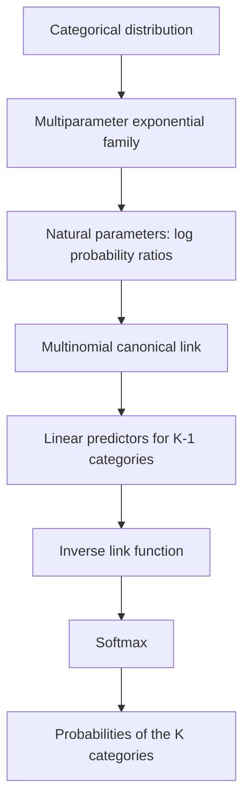

# 5. From the Multinomial Canonical Link to the Softmax Function

In the previous chapter, we showed that the categorical distribution belongs to the multiparameter exponential family and that its natural parameters can be expressed as log ratios of category probabilities.

Choosing category $K$ as the reference, we obtained:

$$
\theta_j=\ln\left(\frac{p_j}{p_K}\right),
\qquad j=1,\ldots,K-1
$$

This relationship provides the starting point for generalizing binary logistic regression to the multiclass setting.

Our goal now is to connect the natural parameters to the linear predictors of a generalized linear model (GLM) and derive the function that transforms these predictors into probabilities for the $K$ categories.

We will show that this function is precisely the **softmax**, widely used in classification models and modern neural network architectures.

## 5.1 The Multinomial Canonical Link

Recall the vector of natural parameters for the categorical distribution:

$$
\boldsymbol\theta=
\begin{pmatrix}
\ln(p_1/p_K)\\
\ln(p_2/p_K)\\
\vdots\\
\ln(p_{K-1}/p_K)
\end{pmatrix}
$$

In the Bernoulli case, we defined the canonical link by setting the natural parameter equal to the linear predictor:

$$
\eta=\theta
$$

In the multinomial case, we can generalize this construction by introducing a linear predictor for each of the $K-1$ non-reference categories.

For an arbitrary observation described by a covariate vector $x$, define:

$$
\eta_j=x^\top\beta_j,
\qquad j=1,\ldots,K-1
$$

where $\beta_j$ denotes the vector of coefficients associated with category $j$. If the model includes an intercept, we assume that $x$ contains a constant component equal to $1$.

As in the previous chapter, we assume that all probabilities are strictly positive: $p_j>0$. This ensures that the log probability ratios and their corresponding natural parameters are finite.

We thus obtain a vector of linear predictors:

$$
\boldsymbol\eta=
\begin{pmatrix}
\eta_1\\
\eta_2\\
\vdots\\
\eta_{K-1}
\end{pmatrix}
$$

Choosing the **multinomial canonical link** means imposing:

$$
\boxed{
\boldsymbol\eta=\boldsymbol\theta
}
$$

Therefore, for each non-reference category:

$$
\boxed{
\ln\left(\frac{p_j}{p_K}\right)
=x^\top\beta_j
}
$$

The canonical link thus takes the following vector-valued form:

$$
\boxed{
g(\mathbf p)=
\begin{pmatrix}
\ln(p_1/p_K)\\
\ln(p_2/p_K)\\
\vdots\\
\ln(p_{K-1}/p_K)
\end{pmatrix}
}
$$

This function is known as the **baseline-category logit link**, because it expresses each category's probability through its ratio to the probability of a reference category.

### Inverting the Canonical Link

Starting from the definition:

$$
\ln\left(\frac{p_j}{p_K}\right)=\eta_j
$$

exponentiate both sides:

$$
\frac{p_j}{p_K}=e^{\eta_j}
$$

Hence:

$$
p_j=p_Ke^{\eta_j}
$$

Use the normalization constraint:

$$
p_K+\sum_{j=1}^{K-1}p_j=1
$$

Substituting:

$$
p_K+\sum_{j=1}^{K-1}p_Ke^{\eta_j}=1
$$

Factoring out $p_K$:

$$
p_K\left(1+\sum_{j=1}^{K-1}e^{\eta_j}\right)=1
$$

We obtain:

$$
\boxed{
p_K=
\frac{1}{1+\sum_{h=1}^{K-1}e^{\eta_h}}
}
$$

For the remaining categories, use the relationship $p_j=p_Ke^{\eta_j}$:

$$
p_j=
\left(
\frac{1}{1+\sum_{h=1}^{K-1}e^{\eta_h}}
\right)e^{\eta_j}
$$

Therefore:

$$
\boxed{
p_j=
\frac{e^{\eta_j}}
{1+\sum_{h=1}^{K-1}e^{\eta_h}},
\qquad j=1,\ldots,K-1
}
$$

We have thus derived the inverse of the multinomial canonical link.

More precisely, the link $g$ maps strictly positive category probabilities to a vector of $K-1$ log ratios; its inverse maps any vector $\boldsymbol\eta\in\mathbb R^{K-1}$ to a unique probability vector in the interior of the simplex. Once a reference category has been chosen, this is a one-to-one correspondence.

This parameterization already defines a **multinomial logistic regression** model, in which the probabilities are determined by the linear predictors for the $K-1$ non-reference categories.

## 5.2 From the Reference Category to the Softmax

The representation derived above explicitly distinguishes category $K$ from the others.

However, we can adopt a more symmetric notation by introducing a vector of $K$ real-valued scores, called *logits*:

$$
\mathbf z=(z_1,z_2,\ldots,z_K)
$$

First, define:

$$
z_j=\eta_j,\qquad j=1,\ldots,K-1
$$

and choose:

$$
z_K=0
$$

Since:

$$
e^{z_K}=e^0=1
$$

the denominator of the probabilities can be rewritten as:

$$
1+\sum_{h=1}^{K-1}e^{\eta_h}=\sum_{h=1}^{K}e^{z_h}
$$

Consequently, we can use a single expression for all $K$ categories:

$$
\boxed{
p_j=\mathrm{softmax}(\mathbf z)_j=\frac{e^{z_j}}{\sum_{h=1}^{K}e^{z_h}}}
$$

This is the **softmax function**.

The softmax transforms a vector of $K$ real numbers into a probability vector:

$$
\mathrm{softmax}:
\mathbb R^K\longrightarrow\Delta_{K-1}^{\circ}
$$

where:

$$
\Delta_{K-1}^{\circ} =
\left\{
\mathbf{p}\in\mathbb{R}^{K} :
p_j>0,\quad
\sum_{j=1}^{K}p_j=1
\right\}
$$

denotes the relative interior of the probability simplex for $K$ categories.

**A clarification:** the softmax with $K$ logits is not injective, because different logit vectors can produce the same distribution. The true inverse of the *baseline-category logit link* is obtained by restricting the softmax to vectors of the form $(\eta_1,\ldots,\eta_{K-1},0)$. Symbolically:

$$
\boxed{g^{-1}(\boldsymbol\eta)=\mathrm{softmax}(\eta_1,\ldots,\eta_{K-1},0)}
$$

Nevertheless, the softmax with $K$ logits is surjective onto the interior of the simplex: every distribution with strictly positive probabilities can be obtained from a suitable logit vector.

The function has two immediate properties.

**Positivity**

Because the exponential function is always strictly positive:

$$
e^{z_j}>0
$$

we have:

$$
p_j>0
$$

for every finite logit.

**Normalization**

Summing the probabilities:

$$
\begin{aligned}
\sum_{j=1}^{K}p_j
&=
\sum_{j=1}^{K}
\frac{e^{z_j}}{\sum_{h=1}^{K}e^{z_h}}\\
&=
\frac{\sum_{j=1}^{K}e^{z_j}}
{\sum_{h=1}^{K}e^{z_h}}\\
&=1
\end{aligned}
$$

We therefore obtain a valid probability vector.

One important question remains: **why can we set $z_K=0$ without restricting the distribution?**

To understand this, we need to examine a fundamental property of the softmax.

## 5.3 Translation Invariance of the Softmax

Consider an arbitrary vector of logits:

$$
\mathbf z=(z_1,z_2,\ldots,z_K)
$$

The corresponding probabilities are:

$$
p_j=
\frac{e^{z_j}}{\sum_{h=1}^{K}e^{z_h}}
$$

Now suppose that we add the same constant $c$ to every component:

$$
z'_j=z_j+c
$$

The new vector is:

$$
\mathbf z'=\mathbf z+c\mathbf1
$$

where $\mathbf1$ denotes a vector of $K$ components, all equal to one.

Apply the softmax:

$$
p'_j=
\frac{e^{z_j+c}}
{\sum_{h=1}^{K}e^{z_h+c}}
$$

Using the properties of exponentials:

$$
p'_j=
\frac{e^{z_j}e^c}
{\sum_{h=1}^{K}e^{z_h}e^c}
$$

Because $e^c$ is common to every term in the denominator, we can factor it out:

$$
p'_j=
\frac{e^{z_j}e^c}
{e^c\sum_{h=1}^{K}e^{z_h}}
$$

Simplifying:

$$
p'_j=
\frac{e^{z_j}}
{\sum_{h=1}^{K}e^{z_h}}
$$

Therefore:

$$
\boxed{
p'_j=p_j
}
$$

We have shown that:

$$
\boxed{\mathrm{softmax}(\mathbf z+c\mathbf1)=\mathrm{softmax}(\mathbf z)}
$$

This property is called **translation invariance**.

It means that adding or subtracting the same quantity from every logit does not change the resulting probabilities.

### Why Do Only Differences Between Logits Matter?

Consider the ratio of the probabilities of two categories, $j$ and $h$:

$$
\frac{p_j}{p_h}=\frac{e^{z_j}/\sum_{r=1}^{K}e^{z_r}}{e^{z_h}/\sum_{r=1}^{K}e^{z_r}}
$$

The denominators cancel:

$$
\frac{p_j}{p_h}=\frac{e^{z_j}}{e^{z_h}}
$$

Therefore:

$$
\boxed{
\frac{p_j}{p_h}=e^{z_j-z_h}
}
$$

Taking the natural logarithm:

$$
\boxed{
\ln\left(\frac{p_j}{p_h}\right)=z_j-z_h
}
$$

This relationship shows that probability ratios depend exclusively on the **differences between logits**.

The absolute values of the logits therefore have no independent probabilistic meaning.

If we increase or decrease every logit by the same amount, their differences remain unchanged, and so do the probability ratios.

Because the probabilities must sum to one, these ratios uniquely determine the distribution.

## 5.4 Why Can We Choose $z_K=0$?

The property just established answers this question.

Consider a generic vector:

$$
\mathbf z=(z_1,z_2,\ldots,z_K)
$$

We know that we can subtract the same constant from every component without changing the probabilities.

Choose:

$$
c=-z_K
$$

This gives the transformed vector:

$$
\mathbf z'=
(z_1-z_K,\ z_2-z_K,\ldots,z_K-z_K)
$$

Therefore:

$$
\boxed{
\mathbf z'=
(z_1-z_K,\ z_2-z_K,\ldots,0)
}
$$

The final component is now zero, but:

$$
\mathrm{softmax}(\mathbf z')=\mathrm{softmax}(\mathbf z)
$$

**We are not assuming that the original logit of category $K$ is zero: we are choosing an equivalent representation of the same distribution.**

Subtracting $z_K$ can be done separately for each observation, even when the reference logit depends on the covariates $x$. In a linear model, the differences $z_j(x)-z_K(x)$ remain linear predictors.

This is possible because the logits are not uniquely determined by the probabilities.

### Connection to the Natural Parameters

In Chapter 4, we defined:

$$
\theta_j=\ln\left(\frac{p_j}{p_K}\right)
$$

From the softmax probability-ratio identity, we know that:

$$
\ln\left(\frac{p_j}{p_K}\right)=z_j-z_K
$$

Therefore:

$$
\boxed{
\theta_j=z_j-z_K
}
$$

If we choose the representation with $z_K=0$, we obtain:

$$
\boxed{
\theta_j=z_j,
\qquad j=1,\ldots,K-1
}
$$

The logits of the non-reference categories thus coincide directly with the natural parameters of the categorical distribution.

This explains why the reference-category representation arises naturally from the exponential-family derivation.

### The Identifiability Problem

The fact that different logit vectors can produce the same distribution introduces redundancy into the parameterization.

For example:

$$
\mathbf z=(2,1,0)
$$

and:

$$
\mathbf z'=(5,4,3)
$$

produce exactly the same probabilities, because:

$$
\mathbf z'=\mathbf z+3\mathbf1
$$

Thus, we cannot distinguish the two vectors by observing the probabilities alone.

This is an **identifiability** problem: multiple parameter configurations represent the same distribution.

In particular, a vector of $K$ logits contains one redundant direction, corresponding to the addition of a common constant.

Only $K-1$ differences are needed to identify the distribution.

This observation concerns the identifiability of **logits for a given observation**. In a regression model with $K$ unconstrained linear predictors, the redundancy also affects the coefficients: adding or subtracting the same coefficient vector for every class does not change the predicted probabilities. Setting the reference class's coefficient vector to zero eliminates this particular redundancy, provided that no additional identifiability problems, such as perfectly collinear covariates, are present.

The choice:

$$
z_K=0
$$

eliminates this redundancy by fixing a reference category.

We can interpret it as choosing a coordinate system: changing the reference changes the values used to represent the distribution, but not the probabilities themselves.

This property is directly connected to the constraint:

$$
\sum_{j=1}^{K}p_j=1
$$

Indeed, the probability vector also has only $K-1$ free coordinates.

In summary, **logit redundancy and the probability normalization constraint are two closely related aspects of the same probabilistic structure**.

Starting with a logit vector produced by a neural network, applying the softmax is theoretically justified by the categorical (or single-trial multinomial) distribution, its membership in the exponential family, and the associated canonical parameterization.

Two fundamental properties emerge from this structure:

1. **Differences between logits represent the log-odds** of the corresponding categories relative to a reference category, and therefore express the distribution's natural parameters.

2. **Probabilities are invariant under a common translation of all logits**, making it possible to set the logit of a chosen reference category to zero without changing the probability distribution.

The softmax thus transforms a vector of unconstrained real values into a probability distribution consistent with the multinomial logistic model.

It is also important to emphasize that:

$$
z_K=0
\quad\not\Rightarrow\quad
p_K=0
$$

Indeed, in the reference-category representation:

$$
p_K=\frac{e^0}{\sum_{h=1}^{K}e^{z_h}}=\frac{1}{\sum_{h=1}^{K}e^{z_h}}
$$

and this probability is strictly positive for finite logits.

## 5.5 Numerical Example with Three Categories

Consider a classification problem with three categories.

Suppose the model produces the following logit vector:

$$
\mathbf z=(2,1,0)
$$

Apply the softmax:

$$
p_j=
\frac{e^{z_j}}
{e^{z_1}+e^{z_2}+e^{z_3}}
$$

The common denominator is:

$$
D=e^2+e^1+e^0
$$

Numerically:

$$
D\approx7.389+2.718+1=11.107
$$

Let us calculate the three probabilities.

**First category**

$$
p_1=\frac{e^2}{D}
\approx0.6652
$$

**Second category**

$$
p_2=\frac{e^1}{D}
\approx0.2447
$$

**Third category**

$$
p_3=\frac{e^0}{D}
\approx0.0900
$$

We obtain:

$$
\boxed{
\mathbf p\approx
(0.6652,\ 0.2447,\ 0.0900)
}
$$

The probabilities sum to one, up to numerical rounding.

| Category | Logit | Probability |
|---|---:|---:|
| Class 1 | $2$ | $66.5\%$ |
| Class 2 | $1$ | $24.5\%$ |
| Class 3 | $0$ | $9.0\%$ |

### Verifying the Log Ratios

Choosing the third category as the reference, we can calculate:

$$
\ln\left(\frac{p_1}{p_3}\right)
=z_1-z_3
$$

Since $z_1=2$ and $z_3=0$:

$$
\boxed{
\ln\left(\frac{p_1}{p_3}\right)=2
}
$$

Similarly:

$$
\boxed{
\ln\left(\frac{p_2}{p_3}\right)=1
}
$$

These are precisely the natural parameters:

$$
\boldsymbol\theta=
\begin{pmatrix}
2\\
1
\end{pmatrix}
$$

### Verifying Translation Invariance

Now consider:

$$
\mathbf z'=(5,4,3)
$$

We have added the constant $3$ to every logit.

Applying the softmax:

$$
\mathrm{softmax}(\mathbf z')=
\left(
\frac{e^5}{e^5+e^4+e^3},
\frac{e^4}{e^5+e^4+e^3},
\frac{e^3}{e^5+e^4+e^3}
\right)
$$

Factoring out $e^3$ from the numerator and denominator of each component:

$$
\mathrm{softmax}(\mathbf z')=
\left(
\frac{e^2}{e^2+e^1+1},
\frac{e^1}{e^2+e^1+1},
\frac{1}{e^2+e^1+1}
\right)
$$

We therefore obtain:

$$
\boxed{\mathrm{softmax}(5,4,3)=\mathrm{softmax}(2,1,0)}
$$

This example confirms that the probabilities depend on differences between logits, not on their absolute values.

## 5.6 Binary Logistic Regression as a Special Case

An important property of the softmax is that binary logistic regression arises naturally as a special case of the multinomial formulation.

Consider:

$$
K=2
$$

The softmax gives:

$$
p_1=
\frac{e^{z_1}}{e^{z_1}+e^{z_2}}
$$

and:

$$
p_2=
\frac{e^{z_2}}{e^{z_1}+e^{z_2}}
$$

Divide the numerator and denominator of the first probability by $e^{z_1}$:

$$
p_1=
\frac{1}{1+e^{z_2-z_1}}
$$

Since:

$$
z_2-z_1=-(z_1-z_2)
$$

we obtain:

$$
\boxed{
p_1=
\frac{1}{1+e^{-(z_1-z_2)}}
}
$$

We recognize the logistic function:

$$
\boxed{
p_1=\sigma(z_1-z_2)
}
$$

Similarly:

$$
p_2=1-p_1
$$

If we choose the second category as the reference and set $z_2=0$, we obtain:

$$
\boxed{
p_1=\sigma(z_1)
}
$$

The logistic function is therefore the special case of the softmax with two categories, applied to the difference between their logits.

We can summarize this relationship as:

$$
\boxed{\mathrm{softmax}((z_1,z_2))_1=\sigma(z_1-z_2)}
$$

This equivalence shows that binary and multinomial logistic regression share the same underlying probabilistic structure.

## 5.7 Interpreting Coefficients in Multinomial Regression

In the binary case, we showed that logistic regression coefficients can be interpreted through odds ratios.

A similar property holds in multinomial logistic regression, although the comparison now concerns the probability of a category relative to that of the reference category.

Recall:

$$
\ln\left(\frac{p_j}{p_K}\right)=x^\top\beta_j
$$

Suppose the model includes a covariate $x_r$ with coefficient $\beta_{jr}$ associated with category $j$.

Increasing $x_r$ by one unit while holding the other covariates constant increases the linear predictor for category $j$ by $\beta_{jr}$.

Therefore:

$$
\Delta\ln\left(\frac{p_j}{p_K}\right)
=\beta_{jr}
$$

Exponentiating:

$$
\boxed{
\frac{
(p_j/p_K)_{\text{after}}
}{
(p_j/p_K)_{\text{before}}
}
=e^{\beta_{jr}}
}
$$

Thus, $e^{\beta_{jr}}$ represents the multiplicative change in the ratio between the probability of category $j$ and that of the reference category, associated with a one-unit increase in the covariate $x_r$.

This quantity is often called the *relative risk ratio* (RRR) in multinomial regression. Here, the term refers to the change in the **ratio between the probabilities of two alternative outcomes** ($p_j/p_K$); it should not be confused with the usual relative risk $P(Y=j\mid x_r+1)/P(Y=j\mid x_r)$, which compares the probability of a single class across covariate values.

In the additive model considered here, without interactions involving $x_r$, this factor remains constant as the other covariates vary. Changing the reference category also changes the coefficients and their corresponding RRRs.

It is important to distinguish this interpretation from the change in the individual probability $p_j$: changing a covariate can affect the probabilities of all categories simultaneously because of the common softmax denominator.

## 5.8 Numerical Stability of the Softmax

Translation invariance is not only a theoretical property: it is also useful in numerical implementations.

The softmax contains exponential terms:

$$
e^{z_j}
$$

For very large logit values, directly computing the exponential can cause numerical overflow.

We can exploit invariance under a common translation by choosing:

$$
m=\max_h z_h
$$

and subtracting $m$ from every logit.

We obtain:

$$
\boxed{
p_j=
\frac{e^{z_j-m}}
{\sum_{h=1}^{K}e^{z_h-m}}
}
$$

This transformation does not change the probabilities in exact arithmetic, but it guarantees that:

$$
z_j-m\leq0
$$

for every category.

Consequently:

$$
0<e^{z_j-m}\leq1
$$

This formulation avoids overflow in the exponentials and is an important component of numerically stable softmax computation.

**A note on numerical precision:** in floating-point arithmetic, very negative values of $z_j-m$ may still cause *underflow*, rounding some exponentials and probabilities to zero. Furthermore, when log probabilities or cross-entropy are required, it is preferable to use numerically stable operations such as `log_softmax`, `logsumexp`, and `cross_entropy`, rather than computing the softmax first and then taking its logarithm.

It is useful to distinguish this operation from choosing a reference category: subtracting the maximum is primarily intended to improve numerical stability, whereas setting $z_K=0$ removes parameter redundancy. Both operations, however, rely on the same mathematical property.

## 5.9 Remarks on the Softmax Function

We have derived the softmax from the categorical distribution by using its exponential-family representation and choosing the multinomial canonical link.

The steps in this derivation can be summarized in the following diagram:

The softmax function is therefore a natural generalization of the binary logistic function.

Its derivation highlights several fundamental properties:

- The resulting probabilities are strictly positive and normalized.
- Probability ratios depend on differences between logits.
- The function is invariant under adding the same constant to all logits.
- The distribution can be represented using $K-1$ free natural parameters.
- The binary logistic function emerges as a special case when $K=2$.

It is important, however, to distinguish the probability distribution from the function used to parameterize it.

The **categorical distribution** defines the probabilistic model of the response, while the **softmax** is a transformation that produces category probabilities from logits.

In the reference-category parameterization, applying the softmax to $(\eta_1,\ldots,\eta_{K-1},0)$ gives the inverse of the multinomial canonical link. The unconstrained $K$-logit softmax provides the same probability parameterization but is not uniquely invertible. Moreover, the softmax is not the only possible transformation for modeling a categorical response: different choices of link function or model structure can lead to alternative probabilistic parameterizations.

Its role becomes especially interesting when combined with the likelihood function of the categorical distribution.

In the next chapter, we will show how this combination leads to **categorical cross-entropy**, one of the main loss functions used to train neural classifiers.

We will also derive why the gradient of cross-entropy with respect to the logits has the form:

$$
\boxed{
\frac{\partial\mathcal L}{\partial z_j}=p_j-y_j
}
$$

This result will allow us to connect the statistical derivation of the softmax directly to the backpropagation and optimization mechanisms used in neural networks.
