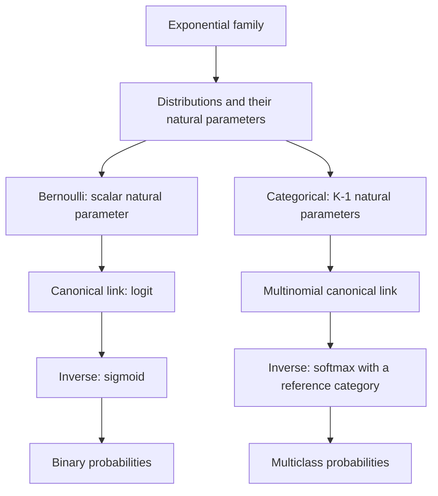

# 8. Conclusions

The aim of this tutorial was to understand the statistical foundations of the softmax function by showing how it can be derived from the theory of Generalized Linear Models (GLMs) and exponential families of distributions.

We followed a path that began with the Bernoulli distribution, led to binary logistic regression, and then extended to its multinomial generalization.

This derivation highlighted that softmax is not merely a normalization function used in neural networks: **under a reference-category parameterization**, it is also the inverse of the canonical link of the categorical distribution.

## 8.1 From the Exponential Family to Softmax

Our starting point was the representation of probability distributions in the exponential family. In the single-parameter form commonly used for GLMs, we can write:

$$
f(y;\theta,\phi)=
\exp\left[
\frac{y\theta-b(\theta)}{a(\phi)}
+c(y,\phi)
\right]
$$

We showed that the cumulant function $b(\theta)$ allows us to derive the expected value and variance of the response from its derivatives:

$$
\mathbb E[Y]=b'(\theta),
\qquad
\mathrm{Var}(Y)=a(\phi)b''(\theta)
$$

The relationship between the expected value and the natural parameter also allows us to define the canonical link, provided that $b'$ is invertible:

$$
\boxed{
g(\mu)=(b')^{-1}(\mu)
}
$$

For the Bernoulli distribution, this construction leads to the logit function:

$$
\mathrm{logit}(p)=
\ln\left(\frac{p}{1-p}\right)
$$

Its inverse is the logistic sigmoid:

$$
\boxed{
\sigma(z)=\frac{1}{1+e^{-z}}
}
$$

Extending the construction to a categorical distribution with $K$ categories, we use the **multiparameter** form of the exponential family and obtain a vector of $K-1$ natural parameters, taking category $K$ as the reference:

$$
\theta_j=
\ln\left(\frac{p_j}{p_K}\right),
\qquad j=1,\ldots,K-1
$$

By inverting the multinomial canonical link, we obtain a transformation from the $K-1$ linear predictors to the $K$ probabilities. Introducing the logit representation $(\eta_1,\ldots,\eta_{K-1},0)$, this transformation coincides with softmax:

$$
\boxed{
g^{-1}(\boldsymbol\eta)
=\mathrm{softmax}(\eta_1,\ldots,\eta_{K-1},0)
}
$$

In the general notation with $K$ logits, the function is:

$$
\boxed{
\mathrm{softmax}(\mathbf z)_j
=\frac{e^{z_j}}{\sum_{h=1}^{K}e^{z_h}},
\qquad j=1,\ldots,K
}
$$

We also demonstrated that probabilities depend on **differences between logits**, rather than on their absolute values. In particular:

$$
\ln\left(\frac{p_j}{p_K}\right)=z_j-z_K
$$

This property explains why softmax is invariant to adding the same constant to every logit:

$$
\boxed{
\mathrm{softmax}(\mathbf z+c\mathbf 1)
=\mathrm{softmax}(\mathbf z)
}
$$

It justifies using a reference category to eliminate parameter redundancy: by subtracting $z_K$ from every logit, we obtain an equivalent vector whose last logit is zero. **Softmax defined on $\mathbb R^K$ is therefore not uniquely invertible**; inversion of the canonical link concerns the identifiable parameterization with $K-1$ coordinates.

The overall derivation can be summarized by the following diagram:

The sigmoid can therefore be interpreted as the binary case of softmax, applied to the difference between two logits:

$$
\mathrm{softmax}(z_1,z_2)_1
=\sigma(z_1-z_2)
$$

## 8.2 The Connection to Neural Network Optimization

The second part of this tutorial showed how the categorical distribution provides a probabilistic foundation for defining the loss function of neural classifiers.

Starting from the likelihood and taking its negative logarithm, we obtained the categorical cross-entropy for a single one-hot-encoded observation:

$$
\boxed{
\mathcal L=-\sum_{j=1}^{K}y_j\ln p_j
}
$$

By combining this loss function with the softmax parameterization, we demonstrated that the gradient of the loss with respect to the logits is:

$$
\boxed{
\frac{\partial\mathcal L}{\partial z_j}=p_j-y_j
}
$$

In vector form:

$$
\boxed{
\nabla_{\mathbf z}\mathcal L
=\mathbf p-\mathbf y
}
$$

This expression establishes a direct connection between probabilistic modeling of the response and the gradient calculations used to train neural networks.

Through the chain rule, the gradient with respect to the logits can be propagated back to the parameters that produced them.

The same principle applies to both multinomial logistic regression, where the logits (or their differences relative to a reference category) are linear combinations of the covariates, and deep neural networks, where they are generated through much more complex transformations.

The main difference therefore lies in the function used to generate the logits, while the probabilistic structure of the categorical output and its corresponding negative log-likelihood remain the same.

## 8.3 The Role of Softmax in Transformers

Finally, we examined two distinct uses of softmax in Transformer architectures.

In **autoregressive language models**, softmax is applied to the output logits to obtain a probability distribution over the next token:

$$
P(w_{t+1}=j\mid w_{\leq t},\psi)
$$

This distribution provides the probabilistic basis for autoregressive prediction and for the loss function used during training.

In **self-attention mechanisms**, by contrast, softmax normalizes compatibility scores between Queries and Keys. For causal self-attention:

$$
\boxed{
A=
\mathrm{softmax}_{\mathrm{rows}}
\left(
\frac{QK^\top}{\sqrt{d_k}}+M
\right)
}
$$

Here, $M$ is the causal mask, which assigns a score of $-\infty$ to future positions, ensuring that the corresponding attention weights are zero.

The resulting values are used to aggregate the Value representations, producing new context-aware representations of the sequence elements.

The mathematical function is the same, but its interpretation depends on the context:

- **At the output**, it parameterizes a categorical distribution over possible tokens or classes.
- **Within attention**, it determines normalized weights for aggregating representations over the positions allowed by the mask.

This distinction is important for understanding Transformers without automatically attributing the same probabilistic interpretation to every softmax operation in the architecture.

## 8.4 Probabilities, Inference, and Interpretive Limitations

We concluded by distinguishing the probability distribution of the response from uncertainty about the model parameters.

We saw that frequentist and Bayesian approaches provide different tools for quantifying the latter, and that the quality of predictive probabilities must also be evaluated using calibration criteria.

Softmax guarantees that, **for finite real-valued logits under the exact mathematical model**, the resulting values are strictly positive and normalized. However, it does not automatically guarantee that predicted probabilities are well calibrated or that they fully characterize the uncertainty associated with the prediction process.

For language models, moreover, token probabilities should not be confused with direct measures of the factual correctness or semantic reliability of the generated text.

The distinction between the probabilistic model, its parameterization, the estimation procedure, and the interpretation of predictions therefore remains essential.

## 8.5 Future Directions

This tutorial provides a theoretical foundation for further exploring Transformer-based neural architectures.

A natural next step is a systematic analysis of a **decoder-only Transformer**, examining its main components and their respective mathematical foundations.

In particular, a subsequent study can connect the framework developed here to token representations through embeddings, the introduction of positional information, causal self-attention and multi-head attention mechanisms, feed-forward networks, normalization layers, and residual connections.

The analysis can then proceed to the complete autoregressive training process, from sequence preparation to loss computation and gradient propagation.

The most important connection established in this tutorial is that **a relatively simple mathematical transformation, such as softmax, can perform different roles within complex architectures while retaining properties derived from a well-defined theoretical framework**.

Understanding these properties allows us not only to use Deep Learning tools correctly, but also to interpret how they work, recognize their limitations, and develop a more systematic view of the mathematical and statistical principles on which they are based.
