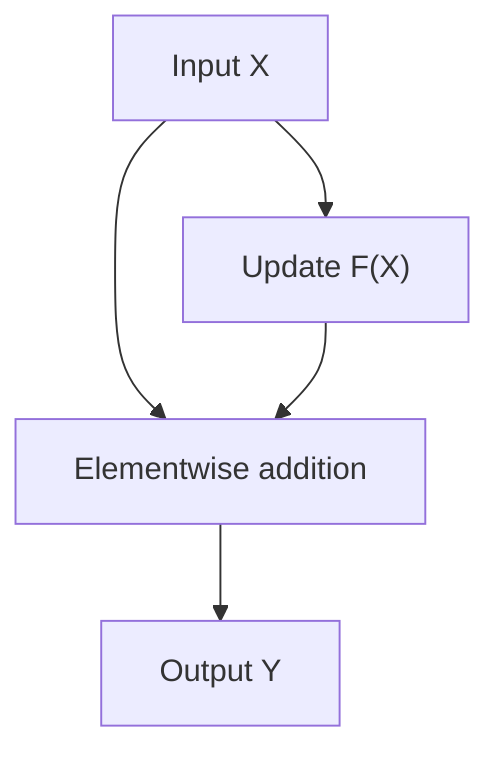

# Residual connections: learning updates to a representation

Attention and feed-forward networks calculate new information from the current token representations. A residual connection adds that information to the representation already present. This gives each sublayer a way to update the representation while providing a direct path through the block.

In this chapter, we will follow both residual additions in our decoder, calculate a numerical example, and derive how the addition changes gradient flow.

Prerequisites: elementwise addition, the shape convention `(batch, token, feature)`, and the chain rule for derivatives. The matrix derivative section extends the scalar explanation.

## 1. The basic operation

A residual connection has the form

$$
Y=X+F(X).
$$

The input takes two paths. The identity path carries $X$ directly to the addition. The other path computes an update $F(X)$, usually through learned transformations.



The result contains both contributions. If the update is zero, the output equals the input. If the update is nonzero, it may reinforce, reduce, or change the signs of individual coordinates.

The word *residual* describes the update relative to the identity mapping. It does not mean the training loss or prediction error. It also does not require the update to be numerically small.

The identity connection itself introduces no trainable parameters. The parameters belong to the branch that computes $F$, such as attention projections, normalization layers, and the feed-forward network.

## 2. The two additions in our decoder block

Our implementation uses pre-normalization:

$$
U=X+\mathrm{Attention}(\mathrm{LN}_1(X)),
$$

$$
Y=U+\mathrm{FFN}(\mathrm{LN}_2(U)).
$$

The first branch normalizes the input, applies causal multi-head attention, and adds the result to the original input. The second branch normalizes the updated representation $U$, applies the feed-forward network, and adds that result to $U$.

The corresponding method in `TransformerDecoderBlock` is:

```python
x = x + self.attn(self.norm1(x))
x = x + self.ffn(self.norm2(x))
return x
```

The second line uses the result of the first line. Both branches therefore contribute sequentially to the same evolving representation.

An expanded version makes the intermediate values explicit:

```python
attention_input = self.norm1(x)
attention_update = self.attn(attention_input)
u = x + attention_update

ffn_input = self.norm2(u)
ffn_update = self.ffn(ffn_input)
y = u + ffn_update
return y
```

Normalization affects the branch input; the identity path carries the unnormalized representation. This is the same pre-norm arrangement introduced in the previous chapter.

Our model contains two decoder blocks, each with these two residual additions, giving four residual additions across the decoder stack.

## 3. Shape compatibility and elementwise addition

Our hidden representation has shape

$$
X\in\mathbb{R}^{B\times T\times4}.
$$

Each update must return to that same shape before it is added:

| Location | Internal representation | Shape at the residual addition |
| --- | --- | --- |
| Identity path | Original hidden representation | `(B, T, 4)` |
| Attention branch | Two heads with two features each, then concatenation and output projection | `(B, T, 4)` |
| Feed-forward branch | Feature width expands from 4 to 16, then contracts to 4 | `(B, T, 4)` |

The addition is coordinate by coordinate:

$$
Y_{b,t,j}=X_{b,t,j}+F(X)_{b,t,j}.
$$

It does not concatenate the vectors or increase the feature width. PyTorch also supports broadcasting in addition, but our residual branches deliberately produce matching shapes; accidental broadcasting could hide a shape error.

Residual architectures with different input and output widths can use a learned projection on the skip path. Our decoder keeps a fixed width of four, so its skip paths are identity mappings and need no projection.

## 4. A numerical example

Consider one token whose current representation is

$$
\mathbf{x}=[1,2,3,4].
$$

Suppose the attention branch produces

$$
\Delta_{\mathrm{attn}}=[0.2,-0.3,0.1,0.4].
$$

The first residual addition gives

$$
\mathbf{u}=\mathbf{x}+\Delta_{\mathrm{attn}}
=[1.2,1.7,3.1,4.4].
$$

Next, suppose the feed-forward branch, evaluated on the normalized version of this updated vector, produces

$$
\Delta_{\mathrm{ffn}}=[-0.1,0.2,0.3,-0.2].
$$

The block output is

$$
\mathbf{y}=\mathbf{u}+\Delta_{\mathrm{ffn}}
=[1.1,1.9,3.4,4.2].
$$

These branch outputs are chosen to illustrate addition; they are not measured outputs of our trained model. In the actual model, the attention update can depend on earlier token positions, while the FFN processes each position separately.

For this example, we can also write

$$
\mathbf{y}=\mathbf{x}+\Delta_{\mathrm{attn}}+\Delta_{\mathrm{ffn}}.
$$

However, the two updates are not independent. Changing the attention update changes $\mathbf{u}$ and therefore generally changes the FFN update too.

## 5. Why learn an update?

Suppose a sublayer should implement some useful transformation $H(X)$. In residual form, its branch can learn

$$
F(X)=H(X)-X,
$$

so that $X+F(X)=H(X)$.

This parameterization provides a direct way to preserve a useful representation: a zero branch output implements the identity mapping. A branch can then modify the representation as training requires. This perspective motivated the original residual-network formulation [1].

It does not imply that all layers should learn tiny corrections, or that preserving the input is always the best choice. Our code also does not explicitly initialize every residual branch to zero, so the blocks should not be assumed to start as exact identity mappings.

## 6. Following the gradient through one addition

Start with a scalar version:

$$
y=x+f(x).
$$

Its derivative is

$$
\frac{dy}{dx}=1+f'(x).
$$

If the gradient arriving from the loss is $g=\partial\mathcal{L}/\partial y$, then the chain rule gives

$$
\frac{\partial\mathcal{L}}{\partial x}
=g\bigl(1+f'(x)\bigr)
=g+g f'(x).
$$

The first term comes through the identity path. The second comes through the learned branch. Because the input participates in both paths, their gradient contributions add.

Without the residual addition, a transformation $y=f(x)$ would contribute only $g f'(x)$. With a residual addition, a small branch derivative does not by itself eliminate the input gradient.

For an illustrative scalar stack with $f(x)=a x$, each residual stage has derivative $1+a$. Across $L$ identical stages, the derivative is $(1+a)^L$. A plain stack of $f(x)=a x$ instead has derivative $a^L$. If $a=0.01$ and $L=10$, these are approximately $1.1046$ and $10^{-20}$ respectively. This is a simplified calculation that isolates the effect of adding the identity; it is not a prediction of our Transformer's gradients.

Residual connections do not guarantee stable gradients. If $f(x)=-x$, the two derivative contributions cancel. If $f(x)=x$, every stage doubles the derivative. The direct path helps explain the optimization benefit, but the complete Jacobian still determines gradient behavior [2].

## 7. Extending the calculation to tensors

Flatten the hidden tensor into a vector $\mathbf{x}$ for the purpose of differentiation. This lets us include both feature interactions and attention's interactions between positions.

For

$$
\mathbf{y}=\mathbf{x}+F(\mathbf{x}),
$$

define $J_F$ by $(J_F)_{ij}=\partial F_i/\partial x_j$. Then

$$
J_{\mathbf{y}}=I+J_F.
$$

With gradients represented as column vectors,

$$
\nabla_{\mathbf{x}}\mathcal{L}
=(I+J_F)^\mathsf{T}\nabla_{\mathbf{y}}\mathcal{L}.
$$

In our first residual branch, $F=\mathrm{Attention}\circ\mathrm{LN}_1$, so its Jacobian includes differentiation through both normalization and attention. The identity contribution bypasses both operations.

This differs from a post-norm arrangement such as $Y=\mathrm{LN}(X+\mathrm{Attention}(X))$, where the output normalization also acts on the combined paths. Moving normalization across the addition changes both the forward computation and its derivatives.

For branch parameters $\theta$, the identity path has no direct parameter derivative:

$$
\nabla_\theta\mathcal{L}
=\left(\frac{\partial F}{\partial\theta}\right)^\mathsf{T}
\nabla_{\mathbf{y}}\mathcal{L}.
$$

The branch still receives gradients and learns. A skip connection does not skip parameter training.

## 8. A small autograd example

The following standalone example makes both paths visible in a scalar calculation:

```python
import torch

x = torch.tensor(2.0, dtype=torch.float64, requires_grad=True)
theta = torch.tensor(0.1, dtype=torch.float64, requires_grad=True)

update = theta * x
y = x + update
loss = 0.5 * y.square()
loss.backward()

print(y.item())          # Approximately 2.2
print(x.grad.item())     # Approximately 2.42
print(theta.grad.item()) # Approximately 4.4
```

Here $y=2.2$ and $\partial\mathcal{L}/\partial y=y=2.2$. Therefore,

$$
\frac{\partial\mathcal{L}}{\partial x}
=2.2(1+0.1)=2.42,
$$

$$
\frac{\partial\mathcal{L}}{\partial\theta}
=2.2\times2=4.4.
$$

The input gradient contains $2.2$ through the identity path and $0.22$ through the branch. Autograd accumulates both contributions automatically. Our decoder code does not detach either path; writing `x = x + ...` rebinds the Python variable while retaining the computation graph needed for backpropagation.

## 9. Across the complete decoder stack

Index the four residual sublayers by $\ell$, including their respective normalization operations inside $F_\ell$:

$$
X_{\ell+1}=X_\ell+F_\ell(X_\ell).
$$

Expanding the additions gives

$$
X_4=X_0+\sum_{\ell=0}^{3}F_\ell(X_\ell).
$$

The initial token-plus-position representation and the successive updates therefore contribute to the representation carried through the stack, often called the *residual stream*. Each update depends on the representation at its own stage.

This sum does not imply that the original input can always be recovered from the output: updates can cancel or overwrite information. Also, our model applies a final LayerNorm and vocabulary projection after the stack. The identity paths inside the blocks do not bypass those final operations.

Two additional implementation details matter:

- **Dropout:** the attention output and FFN output include dropout before residual addition. When its probability is nonzero, dropout affects the update branch; the identity path still carries its input. Our default configuration uses `dropout=0.0`.
- **Causality:** elementwise addition introduces no communication between positions. Provided the input and branch output at position $t$ depend only on positions up to $t$, their sum preserves that restriction. The causal attention mask, positionwise normalization, and positionwise FFN maintain it in our decoder.

We have now followed how each branch contributes an update and how gradients return through the two paths. The next chapter examines the feed-forward network that computes the second update in each block.

## References and connections

- [1] He, Zhang, Ren, and Sun, [Deep Residual Learning for Image Recognition](https://arxiv.org/abs/1512.03385), 2015. Introduces residual learning and evaluates it in deep image-recognition networks.
- [2] He, Zhang, Ren, and Sun, [Identity Mappings in Deep Residual Networks](https://arxiv.org/abs/1603.05027), 2016. Analyzes signal propagation through identity skip connections.
- [Previous chapter: layer normalization](https://github.com/emiliano-riva/transformer-decoder-only/blob/main/docs/modules/05-layer-normalization.md).
- [Implementation: `TransformerDecoderBlock`](https://github.com/emiliano-riva/transformer-decoder-only/blob/main/src/tiny_transformer.py).
- [Next chapter: feed-forward network](https://github.com/emiliano-riva/transformer-decoder-only/blob/main/docs/modules/07-feed-forward-network.md).
